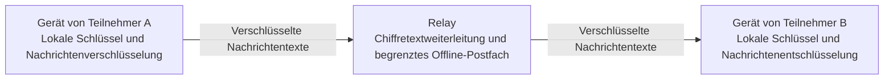

# Alice Talk — Projektübersicht und Forschungsplan

Präsentationsmaterial: [Animation auf Englisch und Türkisch, englischer Audiobeitrag und Infografik](../../media/README.md).

**Übersetzung:** Maßgeblich ist die [englische Referenzfassung](../en/overview.md).

**Arbeitsname:** „Alice Talk“ ist ein vorläufiger Name, angelehnt an Alice und Bob, die üblichen Beteiligten in kryptografischen Beispielen. Der endgültige Produktname wird später gewählt. Der Arbeitsname deutet keine Verbindung zu einer anderen Organisation an.

**Zweck:** Unterlagen für eine erste Prüfung im Rahmen von Förderungen, Entwicklerunterstützung und möglichen Partnerschaften. Dieses Paket wird vor einer etwaigen späteren Veröffentlichung in einem privaten Repository vorbereitet.

**Stand:** Ein unabhängiges Projekt vor der Veröffentlichung mit einem experimentellen Prototyp für verschlüsselte Nachrichten. Die Kombination seiner kryptografischen Verfahren hat noch kein unabhängiges Sicherheits- oder Datenschutzaudit abgeschlossen. Die Agentenschicht und eine umfassendere geräteübergreifende Interoperabilität sind geplante Forschung.

## 1. Ziel des Projekts

Alice Talk untersucht, wie Menschen über verschiedene Geräte kommunizieren und mit KI-Assistenten zusammenarbeiten können, während sie die Kontrolle über Identität, geteilte Inhalte und Aktionen behalten.

Langfristig wird eine Kommunikationsschicht für Telefone, Tablets und Computer angestrebt. Eine Person könnte einer anderen Nachrichten senden, einen Assistenten zu einer bestimmten Aufgabe hinzuziehen oder einem Agenten erlauben, einen anderen um Hilfe zu bitten. Die schlüsselbasierte Identität jedes Beteiligten und die jeweils übertragenen Befugnisse sollen auch beim Wechsel zwischen Geräten oder Systemen erkennbar bleiben.

Das Projekt verfolgt einen gemeinnützigen Nutzen: Kommunikation über Sprach- und Ländergrenzen hinweg, zugänglichere Oberflächen und Zusammenarbeit mit klarer menschlicher Entscheidungshoheit. Dies sind zu prüfende Entwicklungsziele. Daraus folgt nicht, dass bereits ein weltweiter Dienst oder ein vollständig interoperables Agentennetz existiert.

## 2. Aktueller Prototyp und geplante Arbeit

| Bereich | Aktueller Stand |
|---|---|
| Identität | Der Prototyp unterstützt das Erstellen und Wiederherstellen schlüsselbasierter Identitäten. |
| Zulassung | Die experimentelle Nachrichtenumgebung verwendet Einladungen. Die Zulassungsinfrastruktur wird weiterhin von den Betreibern der jeweiligen Installation kontrolliert. |
| Textnachrichten | Experimentelle Eins-zu-eins-Textkommunikation mit dem Entwurfsziel einer Ende-zu-Ende-Verschlüsselung ist implementiert; sie ist nicht unabhängig auditiert. |
| Offline-Zustellung | Ein begrenztes, ausschließlich im RAM gehaltenes Postfach auf Anwendungsebene speichert Chiffretext für einen eingeschränkten Offline-Zustellpfad. Ein Neustart des Relays verwirft wartende Daten. |
| Lokaler Zustand | Identitätsmaterial wird in einem mit einer Passphrase verschlüsselten lokalen Tresor geschützt; ein verschlüsselter lokaler Gesprächsverlauf ist optional. |
| Audio und direkte Verbindungen | Arbeiten an Browser-Audio und direkten Verbindungen liegen vor. Eine breitere Prüfung auf physischen Geräten und in Bereitstellungsumgebungen ist erforderlich. |
| Geräteübergreifende Kommunikation | Eine zentrale Produktrichtung, für die Kompatibilität und Identitätslebenszyklus noch geprüft werden müssen. |
| Mensch–KI- und Agent–Agent-Kommunikation | Eine geplante Forschungserweiterung; eine abgeschlossene Produktionsintegration wird nicht behauptet. |
| Sicherheitsnachweise | Vom Entwickler ausgeführte automatisierte Tests prüfen das Implementierungsverhalten. Ein unabhängiges kryptografisches und datenschutzbezogenes Audit steht noch aus. |

Der aktuelle Messenger setzt Kontaktfreigabe und Sperren durch Anwendungscode für Live-Nachrichten, den Empfang von Offline-Nachrichten und Steuerungsanfragen durch. Für Anrufe, Verlauf und Dateiannahme gibt es aktionsbezogene Nutzerentscheidungen. Ein für einladungsbasierte Zulassung konfiguriertes Relay prüft Schlüsselbesitz und Mitgliedschaft. Dies sind begrenzte Anwendungs- und Protokollkontrollen, kein allgemeines Werkzeugberechtigungssystem für Agenten und kein Beweis vollständiger Sicherheit.

Dieses Dokumentationspaket enthält eine Erläuterung und einen Plan. Es ist keine Implementierungsdistribution, kein unabhängig reproduzierbarer Testbericht und keine Sicherheitszertifizierung.

## 3. Konzeptioneller Ablauf

Der aktuelle Nachrichtenprototyp trennt Identität und Inhaltsverarbeitung an den Endpunkten von der relaygestützten Zustellung.

1. Ein Beteiligter erstellt oder rekonstruiert auf einem Gerät eine kryptografische Identität.
2. Die einladungsbasierte Zulassung regelt den Zugang zur experimentellen Nachrichtenumgebung.
3. Die Endpunkte der Beteiligten stellen eine verschlüsselte Eins-zu-eins-Sitzung her.
4. Der sendende Endpunkt verschlüsselt den Nachrichtentext vor der Weiterleitung über das Relay.
5. Der empfangende Endpunkt prüft die Authentizität anhand der Schlüssel, denen er vertraut, und entschlüsselt die Nachricht.
6. Ein ausdrücklich vorgesehener Offline-Pfad kann Chiffretext vorübergehend innerhalb der Postfachgrenzen aufbewahren.
7. Ein Nutzer kann einen verschlüsselten lokalen Verlauf wählen. Lokale Aufbewahrung und Relay-Zustellung sind getrennte Fragen.

Die Annahme durch das Relay und das Lesen durch den Empfänger sind verschiedene Ereignisse. Ein verfügbarer Übertragungsweg belegt nicht, dass eine andere Person eine Nachricht erhalten oder gelesen hat.

Der Live-Sendepfad unterscheidet die Annahme durch das Relay, eine ausdrückliche Offline-Meldung und ein ungewisses Ergebnis. Nur eine ausdrückliche Offline-Meldung wählt für Text den getrennten Offline-Pfad; ein ungewisses Live-Ergebnis löst keinen automatischen neuen Offline-Versand aus. Diese Regeln begrenzen mehrdeutige Wiederholungen, garantieren aber keine ausnahmslos genau einmalige Zustellung.

## 4. Dezentralisierung und Kontrolle

Die dezentrale Ausrichtung legt die Kontrolle über Identität und private Schlüssel in die Hände der Beteiligten und soll die Abhängigkeit von einer einzigen Kommunikationsinstanz verringern.

Der gegenwärtige Prototyp ist relaygestützt. Er hängt weiterhin von der installationsseitig kontrollierten Zulassung, der Verbindungsinfrastruktur und dem Verhalten der Endpunkte ab. Er bietet weder ein nachgewiesen vertrauensfreies Netz noch globalen Konsens oder eine vollständig dezentrale Governance.

Diese Unterscheidung ist für die Prüfung wesentlich. Kontrolle an den Endpunkten kann nützlich sein, ohne jede Infrastrukturabhängigkeit aufzuheben. Weitere Arbeit muss klären, welche Aufgaben verteilt werden können, welche Annahmen verbleiben und wie sich Ausfälle auswirken.

## 5. Kryptografischer Ansatz

Der Prototyp kombiniert etablierte kryptografische Konstruktionen. Die Sicherheit dieser Kombination muss weiterhin unabhängig bewertet werden.

| Konstruktion | Grundsätzliche Aufgabe |
|---|---|
| Ed25519 | Signaturen für kryptografische Identitäten. |
| X25519 mit einem Prekey-Austausch nach dem X3DH-Prinzip | Anfängliche Vereinbarung von Sitzungsschlüsseln. |
| Double Ratchet | Weiterentwicklung des Schlüsselmaterials im Verlauf eines Gesprächs. |
| XChaCha20-Poly1305 | Authentifizierte Verschlüsselung geschützter Inhalte. |
| Passphrasenverschlüsselter lokaler Tresor | Schutz lokal gespeicherten Identitätsmaterials in versiegeltem Zustand. |

Der Entwurf zielt auf Nachrichtenintegrität, Vertraulichkeit zwischen den beteiligten Endpunkten und wechselnde Sitzungsschlüssel. Diese Absichten sind kein formaler Beweis für Ende-zu-Ende-Sicherheit, Forward Secrecy oder Erholung nach einer Kompromittierung im Gesamtsystem.

Eine kryptografische Identität belegt die Kontrolle über Schlüsselmaterial. Sie belegt weder Ehrlichkeit noch eine geprüfte reale Identität oder die Berechtigung zu einer angeforderten Aktion.

Diese Übersicht lässt Implementierungscode, Paketformate, Parameter der Schlüsselableitung, Bereitstellungsanleitungen und Betriebsdetails bewusst aus. Die Nennung etablierter Konstruktionen stellt keine Kompatibilität mit dem Protokoll eines anderen Produkts her.

## 6. Geplante Mensch–Agent- und Agent–Agent-Schicht

Die Forschungsfrage lautet, ob authentifizierte Kommunikation in Verbindung mit unabhängig von Modellausgaben durchgesetzten Berechtigungen das Verhalten zusammenarbeitender Agenten verbessern kann.

Ein geplanter Austausch würde folgende Entscheidungen getrennt behandeln:

- Wer hat die Anfrage gesendet?
- Welchen Inhalten hat die Person zur Weitergabe zugestimmt?
- Welche Aufgabe oder Aktion wurde autorisiert?
- Welche Empfänger, Werkzeuge und Zeiträume umfasst diese Autorisierung?
- Was soll bei fehlender, abgelaufener, widerrufener oder unklarer Zustimmung geschehen?

Eine Person könnte beispielsweise Agent A erlauben, Agent B um eine Zusammenfassung eines synthetischen Dokuments zu bitten. Diese Erlaubnis wäre auf das angegebene Material und die Aufgabe begrenzt. Sie würde nicht automatisch andere Nachrichten, den Zugriff auf weitere Dokumente oder Aktionen in einer anderen Anwendung erlauben.

Dies ist ein vorgeschlagenes Evaluationsmodell. Der aktuelle Nachrichtenprototyp darf nicht so verstanden werden, als implementiere er bereits dieses Berechtigungssystem für Agenten.

## 7. Datenschutzgrenzen und Einschränkungen

Eine aussagekräftige Bewertung muss auch die Grenzen des Entwurfs berücksichtigen:

- **Endpunkte:** Ein kompromittiertes Gerät, ein Browser oder eine entsperrte Sitzung kann Geheimnisse und Klartext offenlegen.
- **Schlüsselverteilung:** Nachrichtenauthentifizierung bezieht sich auf die Identitätsschlüssel, denen ein Endpunkt vertraut. Ihre Verteilung und die Prüfung von Fingerabdrücken durch Beteiligte gehören zum Vertrauensmodell. Diese Übersicht belegt keinen Schutz vor Schlüsselaustausch durch einen Angreifer.
- **Metadaten:** Relays, Hostinganbieter und Netzinfrastruktur können Verbindungszeiten, Adressen und Kommunikationsbeziehungen beobachten.
- **Direkte Pfade:** Abhängig von der Konfiguration können direkte Audio- oder Datenverbindungen die Netzwerkadresse eines Beteiligten dem anderen Endpunkt offenlegen.
- **Verfügbarkeit:** Ein begrenztes RAM-Offline-Postfach ist vorübergehend. Neustarts, Kapazitätsgrenzen und Verbindungsfehler beeinflussen die Zustellung.
- **Lokale Aufbewahrung:** Auch ein optionaler verschlüsselter Verlauf erzeugt auf dem Gerät gespeicherte Daten.
- **Tresor und Wiederherstellung:** Ein gestohlener versiegelter Tresor kann Offline-Versuchen zum Erraten der Passphrase ausgesetzt sein. Sicherung, Wiederherstellung und Passphrasenstärke benötigen eine eigene Prüfung.
- **Softwarebereitstellung:** Der an einen Browser ausgelieferte Code und seine Bereitstellungsumgebung bleiben Teil der Vertrauensgrenze.
- **Externe Inferenz:** Ein Anbieter sieht alle Inhalte, die an seine Modell-API übermittelt werden.
- **Autorisierung:** Auch eine korrekt authentifizierte Nachricht kann unsichere, irreführende oder nicht autorisierte Anweisungen enthalten.
- **Nachweise:** Unabhängige Sicherheits- und Datenschutzprüfungen sowie eine breitere Gerätevalidierung bleiben erforderlich.

Die frühe Forschung würde synthetisches Material und simulierte Werkzeuge verwenden. Reale private Gespräche, Zugangsdaten oder Produktionszugriffe sind für die geplante Studie nicht erforderlich.

## 8. Geplante Evaluation

Die erste Forschungsphase würde drei Versuchsbedingungen vergleichen:

| Bedingung | Für das Modell sichtbare Information und Durchsetzung |
|---|---|
| Reine Prompt-Baseline | Das Modell erhält Aufgabenanweisungen und ungeprüfte Absenderangaben. Werkzeuge sind simuliert; eine unabhängige Aktionsberechtigungsprüfung fehlt. |
| Authentifizierter Absenderkontext | Die Testumgebung ergänzt ein Ergebnis der Herkunftsprüfung für das Modell. Eine unabhängige Aktionsberechtigungsprüfung kommt nicht hinzu. |
| Authentifizierter Kontext mit unabhängigen Berechtigungen | Das Modell sieht denselben Herkunftskontext. Eine separate deterministische Prüfung kann eine vorgeschlagene simulierte Aktion vor ihrer Ausführung blockieren. |

Geplant sind Fälle mit zitierten Anweisungen innerhalb authentifizierter Nachrichten, gefälschter Delegation, wiederholten Anfragen, abgelaufener Zustimmung, unklarer Autorisierung und Versuchen, den Umfang einer synthetischen Aufgabe zu überschreiten. Es handelt sich um begrenzte Tests mit synthetischen türkisch- und englischsprachigen Gesprächen und simulierten Aktionen. Die Authentifizierung des unmittelbaren Absenders bestätigt nicht Herkunft oder Unbedenklichkeit zitierter Inhalte.

Vorgesehene Messgrößen sind:

- Erledigung berechtigter Aufgaben.
- Vom Modell versuchte unberechtigte Aktionen und tatsächlich ausgeführte unberechtigte simulierte Aktionen, getrennt erfasst.
- Offenlegung synthetischen, zugriffsbeschränkten Materials.
- Fälschliche Ablehnung berechtigter Arbeit.
- Latenz und Ressourcenverbrauch.
- API- oder Rechenkosten.
- Verhalten bei Wiederholungen und ausgewählten Modellen.

Die Hypothese lautet, dass nützliche Aufgabenerledigung erhalten und zugleich unberechtigte Versuche oder Ausführungen reduziert werden können. Eine blockierte Aktion allein belegt kein besseres Urteilsvermögen des Modells. Ergebnisse müssen Modellverhalten und Wirkung der deterministischen Prüfung unterscheiden. Fallzahlen, ausgewählte Modellfamilien, Wiederholungen und Vergleichskriterien würden nach Festlegung des Pilotumfangs und vor den Messläufen erklärt.

Ein Bericht müsste Testsatz, Bezugsgrößen, Modellkonfiguration, Ausführungsbedingungen und Einschränkungen angeben. Dieses Repository behauptet weder Agenten-Benchmark-Ergebnisse noch eine nachgewiesene Wirksamkeitssteigerung.

## 9. Vorläufiger Forschungszeitplan

Der folgende Planungsrahmen hängt von verfügbaren Ressourcen und Prüfergebnissen ab.

| Phase | Geplante Arbeit |
|---|---|
| Monat 1 | Bedrohungsmodell, Umfang, synthetische Aufgaben und Messgrößen festlegen. |
| Monat 2 | Baseline-Experimente aufbauen und Annahmen zu Identität und Zustimmung prüfen. |
| Monat 3 | Authentifizierten Kontext mit separat durchgesetzten Berechtigungen vergleichen. |
| Monat 4 | Ausgewählte Experimente wiederholen und Fehlerfälle untersuchen. |
| Monat 5 | Geräte-, Browser- und Ressourcenprüfungen erweitern, soweit möglich. |
| Monat 6 | Erkenntnisse zusammenführen, offene Lücken benennen und gegebenenfalls eine nicht vertrauliche Zusammenfassung vorbereiten. |

Eine kleinere Förderung würde einen kleineren Pilotversuch ermöglichen. Dieser Zeitplan ist weder eine vertragliche Lieferzusage noch die Behauptung, alle vorgeschlagenen Funktionen würden innerhalb von sechs Monaten fertiggestellt.

## 10. Ressourcenbedarf und Unterstützung

Nützliche Unterstützung kann unterschiedliche Formen annehmen:

- Ein überschaubares Kontingent an Modell-API- oder Inferenzguthaben.
- Begrenzter Zugang zu GPUs oder allgemeiner Rechenleistung.
- Geeignete Entwicklungs- oder Testhardware, einschließlich generalüberholter Geräte.
- Gesponserte Testinfrastruktur.
- Eine kleine Förderung für die eingegrenzte Forschung.

Ein geeigneter Beitrag kann bereits helfen. Es wird nicht von jedem Unterstützer jede Kategorie erwartet.

Als Beispiel könnte ein dreimonatiger Pilot für die Monate 1–3 des Zeitplans ein Guthaben von US$300 so aufteilen: US$60 für Baseline-Erkundung, US$150 für kontrollierte Vergleiche, US$60 für Wiederholungen und US$30 als Reserve. Dies sind Planungsansätze, keine Anbieterangebote oder Aufzeichnungen erhaltener Mittel.

Bevorzugt wird freiwillige, ungebundene Unterstützung ohne Rückzahlung, Eigenkapital- oder Implementierungs-IP-Übertragung, Pflichtkäufe, Exklusivität, verpflichtende Werbung oder vorgeschriebene Liefergegenstände. Angebote und Bedingungen müssten gesondert geprüft werden. Dieses Repository nimmt kein Angebot an, aktiviert keinen kostenpflichtigen Dienst und autorisiert keine Belastung.

## 11. Möglicher Nutzen und nächste Schritte

Besonders aussichtsreich erscheinen folgende Untersuchungsrichtungen:

- Kommunikation mit klarer persönlicher Kontrolle über mehrere Geräte hinweg.
- Ausdrückliche und begrenzte Teilnahme von Assistenten an Gesprächen.
- Bessere Trennung von Nachrichtenherkunft, Inhalt und Aktionsberechtigungen.
- Spätere Interoperabilitätsversuche über Agenten- und Geräteökosysteme hinweg, nach der ersten begrenzten Evaluation.
- Zugänglichere Interaktion durch künftige Sprach- und mehrsprachige Oberflächen.

Der nächste aussagekräftige Meilenstein sind Nachweise: eine eingegrenzte Demonstration, klar beschriebene Messungen, ehrliche Fehleranalyse und eine unabhängige Bewertung der relevanten Sicherheitsannahmen.

## 12. Prüfung und Vertraulichkeit

Dieses Repository soll bei der Bewertung der Projektrichtung und der Eignung eines kleinen Beitrags helfen. Es kann die Sicherheit des privaten Implementierungscodes nicht belegen.

Es enthält weder Implementierungsquellcode noch Zugangsdaten, private Antragsunterlagen oder aktive Betriebskonfiguration. Es gewährt keinen Zugang zu privaten Systemen oder zum geistigen Eigentum der Implementierung. Eine vertiefte technische Prüfung oder die freiwillige Weitergabe zusätzlicher nicht vertraulicher Erkenntnisse wäre gesondert zu besprechen.

Projektverantwortlicher: [kemalayazx](https://github.com/kemalayazx). Kontakt ist über verfügbare Kanäle dieses Profils oder die Korrespondenz möglich, über die dieses Material geteilt wurde.

## 13. Entwicklungsnachweise und Codeumfang

**Geprüfter Stand: 31. Oktober 2026.** Diese Zahlen beschreiben den ausgewählten privaten Implementierungsstand und Entwicklerprüfungen. Sie sind keine unabhängig auditierten Ergebnisse, keine Produktionsgarantie und keine Messungen der vorgeschlagenen Agentenforschung.

### Automatisierte Tests

Ein neuer Lauf der vorhandenen vollständigen automatisierten Testsuite bestand **737 von 737 Tests**, mit **0 Fehlern, 0 Abbrüchen und 0 übersprungenen Tests**. Die Aufteilung: 62 Kryptografietests, 42 Tests verschlüsselter Sitzungen, 56 Protokolltests, 68 Vertrauens- und Zulassungstests, 376 Clienttests, 118 Servertests und 15 Werkzeugtests.

Der erste eingeschränkte Lauf konnte vorübergehende lokale Testverbindungen nicht öffnen und bestand nicht. Ein anschließender Lauf mit den erforderlichen lokalen Testberechtigungen war erfolgreich. Dazwischen wurde die Implementierung nicht verändert. Der Erfolg hebt den umgebungsbedingten Fehlschlag nicht auf und bedeutet nicht, dass entfernte Installationen erneut geprüft wurden.

Private Entwicklungsaufzeichnungen dokumentieren frühere vollständige Ergebnisse von 702 Tests am 6. September 2026, 725 am 7. September und 737 am 9. September. Dies sind datierte Entwicklungsaufzeichnungen, keine voneinander unabhängigen Bestätigungen und keine zu addierenden Zahlen. Sie betreffen unterschiedliche aufeinanderfolgende Stände.

### Beispiele gefundener und bearbeiteter Probleme

| Kategorie | Dokumentierte Korrektur und Regressionstests |
|---|---|
| Arbeit läuft nach Abbruch oder Herunterfahren weiter | Abbruchprüfungen, ausdrückliche Ressourcenfreigabe und serialisierte Dateibereinigung verhindern, dass veraltete asynchrone Arbeit eine gestoppte Laufzeit weiter verändert. |
| Überlappende Identitätseintrittsvorgänge | Versuche erhielten eine eindeutige Lebenszyklusverantwortung. Abgelöste Abschlüsse können keinen veralteten Identitätszustand installieren oder einen ersetzten Speicher erneut versiegeln. Eigene Regressionstests decken diese Wettläufe ab. |
| Anrufe erscheinen vor dem Verbindungsaufbau aktiv | Der Anrufstatus trennt Verbindungsaufbau und verbundenen Medienpfad. Der Beginn der Signalisierung allein gilt nicht als hergestellter Anruf. |
| Unsichere oder unvollständige Verbindungseinrichtung | Die Validierung wurde verschärft, um ungültige Handshake- und Konfigurationszustände zurückzuweisen, statt mit einer teilweisen Einrichtung fortzufahren. |
| Diagnosen geben zu viel Kontext preis | Fehlerdiagnosen wurden auf begrenzte Statuskategorien und boolesche Werte beschränkt. Tests prüfen Zurückweisung oder Maskierung privater Werte. |

Diese Beispiele fassen dokumentierte Entwicklungsarbeit zusammen. Sie veröffentlichen keine Ausnutzungsanleitungen, Implementierungspatches, privaten Formate oder Betriebskonfigurationen und belegen nicht die Beseitigung aller verwandten Fehlerarten.

### Offene oder ungeprüfte Bereiche

Private Integrationsaufzeichnungen enthalten erfolgreiche Versuche mit Live- und Offline-Nachrichten, Wiederverbindung und Neustart ohne Wiederholung bereits verarbeiteter Nachrichten. Sie dokumentieren aber auch sporadische Zeitüberschreitungen bei der Offline-Zustellung, deren Ursache ungeklärt bleibt. Spätere erfolgreiche Läufe und bessere Diagnosen **belegen nicht**, dass dieser Fehler behoben wurde.

Beim Abgleich von Zulassungsrechten im getrennten Betrieb können weiterhin Kollisionen auftreten. Dies ist kein nachgewiesener Konsensmechanismus. Umfassendere Identitätslebenszyklen, direkte Audio- und Datenpfade auf realen Geräten sowie tatsächliche Peer-to-Peer-Dateiübertragungen benötigen weitere Validierung. Erfolgreiche automatisierte Tests schließen diese Lücken nicht aus.

### Messung des Codeumfangs

Die folgenden Werte umfassen ausgewählte versionierte Quell- und Testdateien der Anwendung, gemeinsamen Bibliotheken, Oberfläche und eigenständigen Entwicklerhilfen. Physische Zeilen enthalten Leerzeilen und Kommentare.

| Kategorie | Dateien | Physische Zeilen |
|---|---:|---:|
| Anwendungs- und Bibliotheks-TypeScript ohne Tests | 87 | 27.387 |
| TypeScript-Tests | 70 | 18.852 |
| HTML und CSS der Oberfläche | 2 | 2.205 |
| Eigenständige Entwicklerhilfen | 4 | 2.226 |
| Tests der Hilfswerkzeuge | 3 | 251 |
| **Ausgewählte Quellen und Tests zusammen** | **166** | **50.921** |

Ausgeschlossen sind Dokumentation, Abhängigkeits- und Drittanbieterdateien, Lockdateien, Paketmanifeste, Bereitstellungs- und Konfigurationsdateien, generierte Bundles und Buildausgaben. Enthalten ist auch experimenteller Code, der möglicherweise nicht an die aktive Laufzeit angeschlossen ist. Dies ist eine Momentaufnahme erhaltenen Codes, nicht die insgesamt jemals geschriebene Zeilenzahl oder ein Maß für individuelle Urheberschaft, Funktionsvollständigkeit oder Sicherheit.

Rohprotokolle, private Quellpfade und Implementierungshistorie bleiben außerhalb dieses Präsentationspakets. Weitere nicht vertrauliche Nachweise können gegebenenfalls gesondert besprochen werden.

Die Zeile der Entwicklerhilfen zählt ausgewählte JavaScript-/TypeScript-Hilfen; Shell-Werkzeuge und Buildkonfiguration liegen außerhalb dieser Messung.
