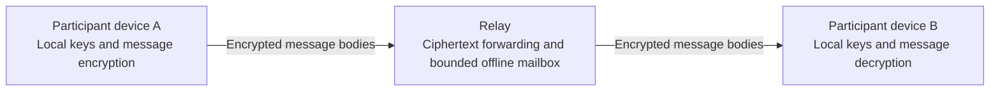

# Alice Talk — Project Overview and Research Plan

Presentation media: [Animated introductions in English and Turkish, English audio and infographic](../../media/README.md).

**Working name:** “Alice Talk” is temporary, inspired by Alice and Bob, the conventional participants in cryptographic examples. A final product name will be chosen later; the working name implies no affiliation with another organization.

**Purpose:** material intended for initial grant, developer-support and potential-partner review. This package is being prepared in a private repository before any later public release.

**Status:** an independent, pre-release project with an experimental encrypted messaging prototype. Its cryptographic composition has not completed an independent security or privacy audit. The agent layer and broader cross-device interoperability are proposed research.

## 1. Project purpose

Alice Talk explores how people can communicate across devices and collaborate with AI assistants while retaining meaningful control over identity, shared content and actions.

The longer-term goal is a communication layer spanning phones, tablets and computers. A person could exchange messages with another person, invite an assistant into a specific task, or allow one agent to request help from another. Each participant's key-based identity and any authority they have delegated should remain clear as the interaction moves between devices or systems.

The project is motivated by public benefit: communication across languages and countries, more accessible interfaces, and collaboration that keeps human authority explicit. These are design objectives to evaluate. They do not establish that a worldwide service or a complete interoperable agent network already exists.

## 2. Current prototype and proposed work

| Area | Current position |
|---|---|
| Identity | Key-based identity creation and restoration exist in the prototype. |
| Admission | The experimental messaging environment uses invitation-based admission. Deployment operators still control admission infrastructure. |
| Text messages | Experimental one-to-one text messaging designed for end-to-end encryption is implemented (unaudited). |
| Offline delivery | A bounded application-level RAM-only mailbox holds ciphertext for a limited offline-delivery path. Restarting the relay loses queued data. |
| Local state | Identity material is protected by a passphrase-encrypted local vault; encrypted local conversation history is optional. |
| Audio and direct connections | Browser audio/direct-link work exists and requires broader physical-device and deployment validation. |
| Communication across devices | A central product direction that still needs compatibility and identity-lifecycle validation. |
| Human–AI and agent–agent communication | A proposed research extension; no completed production integration is claimed. |
| Security assurance | Developer-run automated tests exercise implementation behavior; independent cryptographic and privacy audit remains outstanding. |

The current messenger also applies code-enforced contact approval and blocking to live messages, offline receive filtering and control requests. Calls, history and file acceptance have action-specific user choices. A relay configured for invitation-only admission checks key possession and membership. These are bounded application and protocol controls; they do not constitute a general agent tool-permission system or a proof of complete security.

This documentation package provides an explanation and a plan. It is not an implementation distribution, an independently reproducible test report or a security certification.

## 3. Conceptual operation

The current messaging prototype separates endpoint identity and content handling from relay-assisted delivery.

1. A participant creates or restores a cryptographic identity on a device.
2. Invitation-based admission determines access to the experimental messaging environment.
3. Participant endpoints establish an encrypted one-to-one session.
4. The sending endpoint encrypts the message body before relay delivery.
5. The receiving endpoint checks message authenticity against the keys it trusts and decrypts the message.
6. An explicit offline path can temporarily hold ciphertext within the mailbox's bounds.
7. A user may choose encrypted local history; local retention and relay delivery are separate concerns.

Relay acceptance and recipient reading are different events. An available transport path does not prove that another person received or read a message.

The live-send path distinguishes relay acceptance, an explicit offline result and an uncertain outcome. Only an explicit offline result selects the separate offline path for text; an uncertain live outcome does not cause an automatic fresh offline send. These rules limit ambiguous retries; they are not a universal exactly-once delivery guarantee.

## 4. Decentralization and control

The project's decentralized direction places identity and private-key control with participants and aims to reduce dependence on a single authority over their communication.

The present prototype is relay-assisted. It still depends on deployment-controlled admission, connection infrastructure and the behavior of endpoints. It does not provide a demonstrated trustless network, global consensus or complete decentralized governance.

This distinction matters for review. Endpoint control can be useful without eliminating every infrastructure dependency. Further work must establish which responsibilities can be distributed, what assumptions remain and how failures affect participants.

## 5. Cryptographic approach

The prototype composes established cryptographic constructions. The security of the composition still requires independent assessment.

| Construction | High-level role |
|---|---|
| Ed25519 | Cryptographic identity signatures. |
| X25519 with an X3DH-style prekey exchange | Initial session key agreement. |
| Double Ratchet | Evolution of session key material as a conversation proceeds. |
| XChaCha20-Poly1305 | Authenticated encryption of protected content. |
| Passphrase-encrypted local vault | Protection of local identity material while it is stored in sealed form. |

The design intends to support message integrity, confidentiality between participating endpoints and changing session keys. These intentions are not a formal proof of end-to-end security, forward secrecy or recovery after compromise for the complete system.

A cryptographic identity establishes control of key material. It does not establish that a sender is honest, that a real-world identity has been verified or that a requested action is authorized.

This overview deliberately omits implementation code, packet formats, key-derivation parameters, deployment instructions and operational details. Naming established constructions does not make the prototype compatible with another product's protocol.

## 6. Proposed human–agent and agent–agent layer

The research question is whether authenticated communication, combined with permissions enforced independently of model output, can improve the behavior of collaborating agents.

A proposed interaction would keep several decisions separate:

- Who sent the request?
- What content did the person agree to share?
- What task or action was authorized?
- Which recipient, tool and time window does that authorization cover?
- What should happen when consent is absent, expired, revoked or ambiguous?

For example, a person might authorize Agent A to ask Agent B to summarize a synthetic document. That permission would be limited to the stated material and task. It would not automatically authorize unrelated messages, access to other documents or actions in another application.

This is a proposed evaluation model. The current messaging prototype should not be interpreted as already implementing that agent-permission system.

## 7. Privacy boundaries and limitations

A useful assessment must include the limits of the design:

- **Endpoints:** a compromised device, browser or unlocked session can expose secrets and plaintext.
- **Key distribution:** message authentication is relative to the identity keys an endpoint trusts. How those keys are distributed and how participants verify fingerprints belong in the trust model; this overview does not establish resistance to key substitution.
- **Metadata:** relays, hosting platforms and network infrastructure may observe connection timing, addresses and communication relationships.
- **Direct paths:** depending on connection configuration, a direct audio or data connection may reveal a participant's network address to the other endpoint.
- **Availability:** a bounded RAM-only offline mailbox is temporary. Restarts, capacity limits and connectivity failures affect delivery.
- **Local retention:** optional encrypted history still creates retained data on a participant's device.
- **Vault and recovery:** a stolen sealed vault may be subject to offline passphrase guessing. Backup, restoration and passphrase strength require their own review.
- **Software delivery:** the code delivered to a browser and the surrounding deployment remain part of the trust boundary.
- **External inference:** a provider sees whatever content is submitted to its model API.
- **Authorization:** even a correctly authenticated message may contain unsafe, misleading or out-of-scope instructions.
- **Assurance:** independent security and privacy review, as well as broader device validation, remain necessary.

Early research would use synthetic material and mocked tools. No real private conversations, credentials or production access are needed for the proposed study.

## 8. Proposed evaluation

The first research phase would compare three experimental conditions:

| Condition | Model-visible information and enforcement |
|---|---|
| Prompt-only baseline | The model receives task instructions and unverified sender labels. Tools are mocked; there is no separate action-permission gate. |
| Authenticated sender context | The harness adds a provenance-verification result for the model to consider. It does not add an independent action-permission gate. |
| Authenticated context plus independent permissions | The model sees the same provenance context; a separate deterministic check can block a proposed mocked action before execution. |

Planned cases include quoted instructions inside authenticated messages, forged delegation, replayed requests, expired consent, ambiguous authorization and attempts to exceed a synthetic task's scope. These are bounded tests with synthetic Turkish/English conversations and mocked actions. Authenticating an immediate sender does not authenticate the origin or safety of quoted content.

Proposed measures include:

- Legitimate task completion.
- Unauthorized actions attempted by the model and unauthorized mocked actions executed, recorded separately.
- Disclosure of synthetic restricted material.
- Incorrect refusal of legitimate work.
- Latency and resource consumption.
- API or compute cost.
- Behavior across repeated runs and selected models.

The hypothesis is that useful task completion can be preserved while reducing unauthorized attempts or execution. A blocked action alone does not demonstrate better model judgment: results must distinguish model behavior from the effect of the deterministic gate. Case counts, selected model families, repetitions and comparison criteria would be declared before measured runs, after the pilot scope is fixed.

A report would need to state the test set, denominators, model configuration, run conditions and limitations. No agent benchmark result or effectiveness improvement is claimed in this repository.

## 9. Indicative research schedule

The following is a planning framework, subject to available resources and review findings.

| Phase | Intended work |
|---|---|
| Month 1 | Define the threat model, scope, synthetic tasks and evaluation measures. |
| Month 2 | Establish baseline experiments and check assumptions about identity and consent. |
| Month 3 | Compare authenticated context with separately enforced permissions. |
| Month 4 | Repeat selected experiments and investigate failure cases. |
| Month 5 | Expand device, browser and resource-use validation where feasible. |
| Month 6 | Consolidate findings, identify remaining gaps and prepare a non-confidential review summary where appropriate. |

A smaller award would lead to a smaller pilot. This schedule is not a contractual delivery promise or a claim that every proposed feature will be completed within six months.

## 10. Resource needs and support

Useful support could take several forms:

- A modest allocation of model API or inference credits.
- Bounded GPU or general compute access.
- Appropriate development or test hardware, including refurbished equipment.
- Sponsored testing infrastructure.
- A small grant that supports the scoped research.

One suitable contribution can be useful; the project is not asking every supporter to provide every category.

For illustration, a three-month pilot covering Months 1–3 of the schedule could use a US$300 credit allocation: US$60 for baseline exploration, US$150 for controlled comparisons, US$60 for repeated runs and US$30 for contingency. These are planning allocations, not provider price quotations or a record of funds received.

Unrestricted voluntary support is preferred, without repayment, equity or implementation-IP transfer, required purchases, exclusivity, compulsory promotion or mandatory deliverables. Offers and any proposed conditions would need separate review. Nothing in this repository accepts an offer, activates a paid service or authorizes charges.

## 11. Potential value and next steps

The most promising areas for investigation are:

- Communication that keeps a person's control clear across devices.
- Explicit, limited participation by assistants in a conversation.
- Better separation of message provenance, content and action permissions.
- Later interoperability experiments across agent and device ecosystems, beyond the first bounded evaluation.
- More accessible interaction through future voice and multilingual interfaces.

The next meaningful milestone is evidence: a bounded demonstration, clearly described measurements, honest failure analysis and an independent assessment of the relevant security assumptions.

## 12. Review and confidentiality

This repository is intended to help a reviewer assess the project's direction and the fit of a small contribution. It cannot establish the security of private implementation code.

It contains no implementation source, credentials, private application records or live operational configuration. It does not grant access to private systems or implementation intellectual property. Any deeper technical review or voluntary sharing of additional non-confidential findings would be a separate discussion.

Project owner: [kemalayazx](https://github.com/kemalayazx). Contact through that profile's available channels or the correspondence through which this material was shared.

## 13. Engineering evidence and development scale

**Snapshot reviewed: 31 October 2026.** These figures describe the selected private implementation snapshot and developer-run checks. They are not independently audited results, a production guarantee or measurements of the proposed agent research.

### Automated tests

A fresh run of the existing complete automated suite passed **737 of 737 tests**, with **0 failures, 0 cancellations and 0 skipped tests**. The breakdown was 62 cryptography tests, 42 encrypted-session tests, 56 protocol tests, 68 trust/admission tests, 376 client tests, 118 server tests and 15 tooling tests.

The first restricted run could not open temporary local test connections and did not pass. A subsequent run with the required local test permissions completed successfully. No implementation changes were made between those runs. The successful result should not erase the failed environment check or imply that remote deployments were tested again.

Private development records also document earlier complete-suite results of 702 tests on 6 September 2026, 725 on 7 September and 737 on 9 September. These are dated development records, not separate independent attestations or numbers to add together. They concern different successive snapshots.

### Examples of issues found and addressed

| Issue category | Recorded correction and regression focus |
|---|---|
| Work continuing after cancellation or shutdown | Cancellation guards, explicit resource release and serialized file cleanup were introduced so stale asynchronous work cannot continue changing a stopped runtime. |
| Overlapping identity-entry operations | Entry attempts were given lifecycle ownership; superseded completions cannot install stale identity state or reseal a replacement store. Dedicated regression cases cover these races. |
| Calls appearing active before a connection exists | The call state distinguishes connection setup from a connected media path. Starting signaling alone is not treated as a completed call. |
| Unsafe or incomplete connection setup | Validation was tightened to reject invalid handshake and configuration states rather than continuing with partial setup. |
| Diagnostics exposing too much context | Failure diagnostics were restricted to bounded status categories and booleans; tests check rejection or redaction of private values. |

These examples summarize recorded development work. They do not disclose exploit instructions, implementation patches, private formats or operational configuration, and they do not establish that every related failure mode has been eliminated.

### What remains unresolved or unverified

Private integration records include successful live/offline messaging, reconnect and restart/no-replay exercises. They also record intermittent offline-delivery timeouts whose cause remains unexplained. Later successful runs and better diagnostics do **not** establish that this defect was fixed.

Disconnected admission-right reconciliation can still surface a collision; it is not a demonstrated consensus mechanism. Wider identity-lifecycle coverage, real-device direct audio/data paths and actual peer-to-peer file-transfer behavior still need further validation. Passing automated tests is compatible with these remaining gaps.

### Code-size measurement

The following counts cover tracked, selected source and test files in the application, shared libraries, UI and standalone developer helpers. A physical line includes blank lines and comments.

| Category | Files | Physical lines |
|---|---:|---:|
| Application and shared-library TypeScript, excluding tests | 87 | 27,387 |
| TypeScript tests | 70 | 18,852 |
| UI HTML and CSS | 2 | 2,205 |
| Standalone developer helpers | 4 | 2,226 |
| Helper tests | 3 | 251 |
| **Selected source and tests combined** | **166** | **50,921** |

Documentation, dependency/vendor files, lockfiles, package manifests, deployment/configuration files, generated bundles and build output are excluded. The count includes experimental code that may not be connected to the active runtime. It is a snapshot of retained code, not the lifetime number of lines written, a measure of individual authorship, feature completeness or security.

Raw logs, private source paths and implementation history remain outside this presentation package. More detailed non-confidential evidence can be discussed separately if appropriate.

The developer-helper row counts selected JavaScript/TypeScript helpers; shell utilities and build configuration are outside this measurement.
