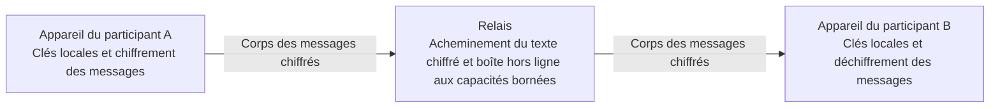

# Alice Talk — Présentation du projet et plan de recherche

**Nom provisoire :** Alice Talk est un nom de travail provisoire inspiré des personnages Alice et Bob habituellement utilisés dans les exemples de cryptographie. Le nom définitif du produit sera choisi ultérieurement ; ce nom de travail n’implique aucune affiliation avec une autre organisation.

**Traduction :** traduction assistée. La [référence anglaise](../en/overview.md) fait autorité.

**Objet :** document destiné à une première évaluation en vue d’une subvention, d’un soutien aux développeurs ou d’un éventuel partenariat. Ce dossier est préparé dans un dépôt privé avant toute publication ultérieure.

**État du projet :** projet indépendant, encore en phase de préversion, comprenant un prototype expérimental de messagerie chiffrée. L’assemblage de ses mécanismes cryptographiques n’a pas encore fait l’objet d’un audit indépendant de sécurité ou de protection de la vie privée mené à son terme. La couche d’agents et l’interopérabilité élargie entre appareils relèvent de recherches proposées.

## 1. Objectif du projet

Alice Talk étudie comment permettre aux personnes de communiquer entre différents appareils et de collaborer avec des assistants d’IA tout en conservant un contrôle réel sur leur identité, les contenus partagés et les actions effectuées.

À plus long terme, l’objectif est de créer une couche de communication couvrant les téléphones, les tablettes et les ordinateurs. Une personne pourrait échanger des messages avec une autre, inviter un assistant à participer à une tâche précise ou permettre à un agent de solliciter l’aide d’un autre. L’identité de chaque participant fondée sur des clés et les pouvoirs qu’il a éventuellement délégués devraient rester clairs lorsque l’interaction passe d’un appareil ou d’un système à un autre.

Le projet poursuit une finalité d’intérêt public : faciliter la communication entre langues et pays, rendre les interfaces plus accessibles et permettre une collaboration dans laquelle l’autorité humaine reste explicite. Ce sont des objectifs de conception à évaluer. Ils ne signifient pas qu’un service mondial ou un réseau complet d’agents interopérables existe déjà.

## 2. Prototype actuel et travaux proposés

| Domaine | Situation actuelle |
|---|---|
| Identité | Le prototype permet de créer et de restaurer une identité fondée sur des clés. |
| Admission | L’environnement expérimental de messagerie utilise une admission sur invitation. Les opérateurs du déploiement contrôlent toujours l’infrastructure d’admission. |
| Messages texte | Une messagerie texte expérimentale entre deux participants, conçue pour le chiffrement de bout en bout, est implémentée (non auditée). |
| Livraison hors ligne | Une boîte de réception aux capacités bornées, conservée uniquement en RAM au niveau applicatif, stocke du texte chiffré pour un mécanisme limité de livraison hors ligne. Un redémarrage du relais entraîne la perte des données en attente. |
| État local | Les éléments d’identité sont protégés par un coffre local chiffré à l’aide d’une phrase secrète ; l’historique local chiffré des conversations est facultatif. |
| Audio et connexions directes | Des travaux sur l’audio dans le navigateur et les liaisons directes existent et nécessitent une validation plus large sur des appareils physiques et dans des environnements de déploiement. |
| Communication entre appareils | Il s’agit d’un axe central du produit, qui nécessite encore une validation de la compatibilité et du cycle de vie des identités. |
| Communication humain–IA et agent–agent | Il s’agit d’une extension de recherche proposée ; aucune intégration achevée destinée à la production n’est revendiquée. |
| Assurance de sécurité | Des tests automatisés exécutés par le développeur vérifient le comportement de l’implémentation ; un audit indépendant de la cryptographie et de la protection de la vie privée reste à réaliser. |

Ce dossier documentaire fournit une explication et un plan. Il ne constitue ni une distribution de l’implémentation, ni un rapport de tests reproductibles de manière indépendante, ni une certification de sécurité.

## 3. Fonctionnement conceptuel

Le prototype actuel de messagerie sépare la gestion de l’identité et des contenus aux terminaux de la livraison assistée par un relais.

1. Un participant crée ou restaure une identité cryptographique sur un appareil.
2. L’admission sur invitation détermine l’accès à l’environnement expérimental de messagerie.
3. Les terminaux des participants établissent une session chiffrée entre deux participants.
4. Le terminal émetteur chiffre le corps du message avant sa transmission par le relais.
5. Le terminal destinataire vérifie l’authenticité du message au regard des clés auxquelles il fait confiance, puis le déchiffre.
6. Un mécanisme hors ligne explicite peut conserver temporairement le texte chiffré dans les limites de la boîte de réception.
7. Un utilisateur peut choisir de conserver un historique local chiffré ; la conservation locale et la livraison par le relais sont des questions distinctes.

L’acceptation par le relais et la lecture par le destinataire sont deux événements différents. La disponibilité d’un chemin de transport ne prouve pas qu’une autre personne a reçu ou lu un message.

## 4. Décentralisation et contrôle

L’orientation décentralisée du projet confie aux participants le contrôle de leur identité et de leurs clés privées et vise à réduire la dépendance à une autorité unique sur leurs communications.

Le prototype actuel est assisté par un relais. Il dépend encore d’un mécanisme d’admission contrôlé par le déploiement, de l’infrastructure de connexion et du comportement des terminaux. Il ne fournit pas de démonstration d’un réseau sans hypothèse de confiance, d’un consensus mondial ou d’une gouvernance entièrement décentralisée.

Cette distinction est importante pour l’évaluation. Le contrôle exercé aux terminaux peut être utile sans supprimer toutes les dépendances à l’infrastructure. Les travaux futurs doivent déterminer quelles responsabilités peuvent être distribuées, quelles hypothèses subsistent et comment les défaillances affectent les participants.

## 5. Approche cryptographique

Le prototype assemble des constructions cryptographiques établies. La sécurité de cet assemblage nécessite encore une évaluation indépendante.

| Construction | Rôle général |
|---|---|
| Ed25519 | Signatures d’identité cryptographique. |
| X25519 avec un échange de préclés de type X3DH | Accord initial sur les clés de session. |
| Double Ratchet | Évolution des éléments de clé de session au fil d’une conversation. |
| XChaCha20-Poly1305 | Chiffrement authentifié des contenus protégés. |
| Coffre local chiffré à l’aide d’une phrase secrète | Protection des éléments d’identité locaux lorsqu’ils sont stockés sous forme scellée. |

La conception vise à prendre en charge l’intégrité des messages, la confidentialité entre les terminaux participants et le renouvellement des clés de session. Ces intentions ne constituent pas une preuve formelle de la sécurité de bout en bout, de la confidentialité persistante ou du rétablissement de la sécurité après compromission pour l’ensemble du système.

Une identité cryptographique établit le contrôle d’éléments de clé. Elle n’établit pas qu’un expéditeur est honnête, qu’une identité dans le monde réel a été vérifiée ou qu’une action demandée est autorisée.

Cette présentation omet délibérément le code d’implémentation, les formats de paquets, les paramètres de dérivation des clés, les instructions de déploiement et les détails opérationnels. Citer des constructions établies ne rend pas le prototype compatible avec le protocole d’un autre produit.

## 6. Couche humain–agent et agent–agent proposée

La question de recherche est de savoir si une communication authentifiée, associée à des permissions appliquées indépendamment des sorties du modèle, peut améliorer le comportement d’agents qui collaborent.

Une interaction proposée maintiendrait plusieurs décisions distinctes :

- Qui a envoyé la demande ?
- Quels contenus la personne a-t-elle accepté de partager ?
- Quelle tâche ou action a été autorisée ?
- Quels destinataire, outil et intervalle de temps cette autorisation couvre-t-elle ?
- Que doit-il se passer lorsque le consentement est absent, expiré, révoqué ou ambigu ?

Par exemple, une personne pourrait autoriser l’agent A à demander à l’agent B de résumer un document synthétique. Cette permission serait limitée aux éléments et à la tâche indiqués. Elle n’autoriserait pas automatiquement des messages sans rapport, l’accès à d’autres documents ou des actions dans une autre application.

Il s’agit d’un modèle d’évaluation proposé. Le prototype actuel de messagerie ne doit pas être interprété comme implémentant déjà ce système de permissions pour les agents.

## 7. Limites en matière de vie privée et autres restrictions

Une évaluation utile doit prendre en compte les limites de la conception :

- **Terminaux :** la compromission d’un appareil, d’un navigateur ou d’une session déverrouillée peut exposer des secrets et du texte en clair.
- **Distribution des clés :** l’authentification des messages est relative aux clés d’identité auxquelles un terminal fait confiance. La distribution de ces clés et la vérification de leurs empreintes par les participants font partie du modèle de confiance ; cette présentation n’établit pas la résistance à la substitution de clés.
- **Métadonnées :** les relais, les plateformes d’hébergement et l’infrastructure réseau peuvent observer les horaires des connexions, les adresses et les relations de communication.
- **Liaisons directes :** selon la configuration de la connexion, une liaison audio ou de données directe peut révéler l’adresse réseau d’un participant à l’autre terminal.
- **Disponibilité :** une boîte hors ligne aux capacités bornées, conservée uniquement en RAM, est temporaire. Les redémarrages, les limites de capacité et les défaillances de connectivité affectent la livraison.
- **Conservation locale :** même facultatif et chiffré, un historique crée des données conservées sur l’appareil d’un participant.
- **Coffre et récupération :** un coffre scellé volé peut faire l’objet de tentatives de découverte de la phrase secrète hors ligne. La sauvegarde, la restauration et la robustesse de la phrase secrète nécessitent leur propre examen.
- **Distribution du logiciel :** le code transmis à un navigateur et le déploiement qui l’entoure restent dans le périmètre de confiance.
- **Inférence externe :** un fournisseur voit tout contenu soumis à l’API de son modèle.
- **Autorisation :** même un message correctement authentifié peut contenir des instructions dangereuses, trompeuses ou hors périmètre.
- **Assurance :** un examen indépendant de la sécurité et de la protection de la vie privée, ainsi qu’une validation plus large sur différents appareils, restent nécessaires.

Les premières recherches utiliseraient des éléments synthétiques et des outils simulés. Aucune conversation privée réelle, aucun identifiant secret et aucun accès à un environnement de production ne sont nécessaires à l’étude proposée.

## 8. Évaluation proposée

La première phase de recherche comparerait trois conditions expérimentales :

| Condition | Informations visibles par le modèle et mécanismes de contrôle |
|---|---|
| Référence fondée uniquement sur les instructions du prompt | Le modèle reçoit les instructions de la tâche et des étiquettes d’expéditeur non vérifiées. Les outils sont simulés ; aucun contrôle distinct des permissions d’action n’intervient. |
| Contexte d’expéditeur authentifié | Le banc d’essai ajoute un résultat de vérification de la provenance que le modèle peut prendre en compte. Il n’ajoute aucun contrôle indépendant des permissions d’action. |
| Contexte authentifié et permissions indépendantes | Le modèle voit le même contexte de provenance ; une vérification déterministe distincte peut bloquer une action simulée proposée avant son exécution. |

Les cas prévus comprennent des instructions citées à l’intérieur de messages authentifiés, des délégations falsifiées, des demandes rejouées, des consentements expirés, des autorisations ambiguës et des tentatives de dépassement du périmètre d’une tâche synthétique. Il s’agit de tests délimités utilisant des conversations synthétiques en turc et en anglais, ainsi que des actions simulées. Authentifier l’expéditeur immédiat n’authentifie ni l’origine ni la sûreté du contenu cité.

Les mesures proposées comprennent :

- L’accomplissement des tâches légitimes.
- Les actions non autorisées tentées par le modèle et les actions simulées non autorisées exécutées, comptabilisées séparément.
- La divulgation d’éléments synthétiques à accès restreint.
- Le refus erroné d’un travail légitime.
- La latence et la consommation de ressources.
- Le coût des API ou du calcul.
- Le comportement au fil d’exécutions répétées et sur les modèles sélectionnés.

L’hypothèse est qu’il est possible de préserver l’accomplissement de tâches utiles tout en réduisant les tentatives ou les exécutions non autorisées. Le blocage d’une action ne démontre pas, à lui seul, un meilleur jugement du modèle : les résultats doivent distinguer le comportement du modèle de l’effet du contrôle déterministe. Le nombre de cas, les familles de modèles retenues, les répétitions et les critères de comparaison seraient déclarés avant les exécutions mesurées, après fixation du périmètre du pilote.

Un rapport devrait préciser le jeu de tests, les dénominateurs, la configuration des modèles, les conditions d’exécution et les limites. Aucun résultat de benchmark d’agents ni aucune amélioration d’efficacité ne sont revendiqués dans ce dépôt.

## 9. Calendrier indicatif de recherche

Le cadre de planification ci-dessous dépend des ressources disponibles et des conclusions des examens.

| Phase | Travaux envisagés |
|---|---|
| Mois 1 | Définir le modèle de menace, le périmètre, les tâches synthétiques et les mesures d’évaluation. |
| Mois 2 | Mettre en place les expériences de référence et vérifier les hypothèses relatives à l’identité et au consentement. |
| Mois 3 | Comparer le contexte authentifié avec des permissions appliquées séparément. |
| Mois 4 | Répéter certaines expériences et étudier les cas d’échec. |
| Mois 5 | Élargir, lorsque cela est possible, la validation des appareils, des navigateurs et de l’utilisation des ressources. |
| Mois 6 | Regrouper les résultats, relever les lacunes restantes et préparer, s’il y a lieu, une synthèse non confidentielle destinée à l’examen. |

Une subvention plus limitée conduirait à un projet pilote plus restreint. Ce calendrier ne constitue ni une promesse contractuelle de livraison ni l’affirmation que toutes les fonctionnalités proposées seront achevées en six mois.

## 10. Besoins en ressources et soutien

Un soutien utile pourrait prendre plusieurs formes :

- Une allocation modeste de crédits pour des API de modèles ou de l’inférence.
- Un accès limité à des GPU ou à des ressources de calcul générales.
- Du matériel de développement ou de test adapté, y compris du matériel reconditionné.
- Une infrastructure de test sponsorisée.
- Une petite subvention soutenant les recherches délimitées.

Une seule contribution adaptée peut être utile ; le projet ne demande pas à chaque soutien de fournir toutes ces catégories.

À titre d’illustration, un projet pilote de trois mois couvrant les mois 1 à 3 du calendrier pourrait utiliser une allocation de crédits de US$300 : US$60 pour l’exploration de référence, US$150 pour les comparaisons contrôlées, US$60 pour les exécutions répétées et US$30 pour les imprévus. Il s’agit d’allocations de planification, et non de devis tarifaires de fournisseurs ou d’un relevé de fonds reçus.

Un soutien volontaire sans restriction est privilégié, sans remboursement, participation au capital ou transfert de propriété intellectuelle relative à l’implémentation, sans achats imposés, exclusivité, promotion obligatoire ou livrables obligatoires. Les offres et leurs éventuelles conditions devraient faire l’objet d’un examen distinct. Rien dans ce dépôt n’accepte une offre, n’active un service payant ou n’autorise une facturation.

## 11. Valeur potentielle et prochaines étapes

Les pistes de recherche les plus prometteuses sont :

- Une communication dans laquelle le contrôle exercé par une personne reste clair d’un appareil à l’autre.
- Une participation explicite et limitée des assistants à une conversation.
- Une meilleure séparation entre la provenance des messages, leur contenu et les permissions d’action.
- Des expériences ultérieures d’interopérabilité entre écosystèmes d’agents et d’appareils, au-delà de la première évaluation délimitée.
- Des interactions plus accessibles grâce à de futures interfaces vocales et multilingues.

Le prochain jalon significatif est la production d’éléments probants : une démonstration délimitée, des mesures clairement décrites, une analyse honnête des échecs et une évaluation indépendante des hypothèses de sécurité pertinentes.

## 12. Examen et confidentialité

Ce dépôt vise à aider un évaluateur à apprécier l’orientation du projet et la pertinence d’une contribution modeste. Il ne peut pas établir la sécurité du code d’implémentation privé.

Il ne contient aucun code source d’implémentation, identifiant secret, dossier de candidature privé ou configuration opérationnelle en service. Il n’accorde aucun accès à des systèmes privés ni à la propriété intellectuelle de l’implémentation. Tout examen technique plus approfondi ou partage volontaire de résultats non confidentiels supplémentaires ferait l’objet d’une discussion distincte.

Responsable du projet : [kemalayazx](https://github.com/kemalayazx). Vous pouvez prendre contact par les canaux disponibles sur ce profil ou par la correspondance dans laquelle ce document a été partagé.

## 13. Éléments d’ingénierie et ampleur du développement

**État examiné : 31 octobre 2026.** Ces chiffres décrivent la version privée sélectionnée et les vérifications effectuées par le développeur. Ils ne constituent ni des résultats audités indépendamment, ni une garantie de fonctionnement en production, ni des mesures de la recherche proposée sur les agents.

### Tests automatisés

Une nouvelle exécution de la suite automatisée complète existante a réussi **737 tests sur 737**, avec **0 échec, 0 annulation et 0 test ignoré**. Répartition : 62 tests de cryptographie, 42 de sessions chiffrées, 56 de protocole, 68 de confiance et d’admission, 376 du client, 118 du serveur et 15 des outils.

La première exécution dans un environnement restreint ne pouvait pas ouvrir les connexions locales temporaires nécessaires aux tests et n’a pas réussi. Une exécution ultérieure, avec les autorisations locales requises, s’est achevée avec succès. Aucun changement de l’implémentation n’a été effectué entre ces exécutions. Le succès ne doit pas effacer l’échec lié à l’environnement ni laisser croire que les déploiements distants ont été testés de nouveau.

Les archives privées de développement consignent également des résultats antérieurs de la suite complète : 702 tests le 6 septembre 2026, 725 le 7 septembre et 737 le 9 septembre. Ce sont des archives datées, pas des attestations indépendantes distinctes ni des nombres à additionner. Elles portent sur des versions successives différentes.

### Exemples de problèmes détectés et traités

| Catégorie | Correction consignée et objet des tests de régression |
|---|---|
| Travail poursuivi après annulation ou arrêt | Des contrôles d’annulation, une libération explicite des ressources et un nettoyage séquentiel des fichiers ont été introduits pour empêcher des opérations asynchrones périmées de modifier un environnement arrêté. |
| Opérations d’entrée d’identité qui se chevauchent | Chaque tentative possède son propre cycle de vie ; une opération remplacée ne peut plus installer un ancien état d’identité ni sceller de nouveau le stockage de remplacement. Des cas de régression dédiés couvrent ces courses. |
| Appels affichés comme actifs avant la connexion | L’état de l’appel distingue l’établissement de connexion d’un chemin média effectivement connecté. Le démarrage de la signalisation ne suffit pas à considérer l’appel comme établi. |
| Établissement de connexion incomplet ou non sûr | La validation a été renforcée pour rejeter les états de négociation et de configuration invalides au lieu de poursuivre une initialisation partielle. |
| Diagnostics révélant trop de contexte | Les diagnostics d’échec sont limités à des catégories d’état bornées et à des booléens ; des tests vérifient le rejet ou le masquage des valeurs privées. |

Ces exemples résument le travail de développement consigné. Ils ne divulguent ni mode d’exploitation, ni correctif d’implémentation, ni format privé, ni configuration opérationnelle. Ils ne prouvent pas que tous les modes de défaillance associés ont été éliminés.

### Points non résolus ou non vérifiés

Les archives privées d’intégration comprennent des exercices réussis de messagerie en ligne et hors ligne, de reconnexion et de redémarrage sans rejeu. Elles consignent aussi des délais d’attente intermittents lors de la livraison hors ligne, dont la cause reste inexpliquée. Des exécutions ultérieures réussies et de meilleurs diagnostics ne **prouvent pas** que ce défaut a été corrigé.

La réconciliation des droits d’admission en mode déconnecté peut encore faire apparaître une collision ; ce n’est pas un mécanisme de consensus démontré. Une couverture plus large du cycle de vie des identités, les chemins audio/données directs sur appareils physiques et le comportement réel du transfert de fichiers entre pairs demandent encore des validations. La réussite des tests automatisés est compatible avec ces lacunes.

### Mesure de la taille du code

Les comptes suivants portent sur les fichiers sources et de tests sélectionnés, suivis dans le contrôle de version, de l’application, des bibliothèques partagées, de l’interface et des utilitaires de développement autonomes. Les lignes physiques comprennent les lignes vides et les commentaires.

| Catégorie | Fichiers | Lignes physiques |
|---|---:|---:|
| TypeScript de l’application et des bibliothèques, hors tests | 87 | 27 387 |
| Tests TypeScript | 70 | 18 852 |
| HTML et CSS de l’interface | 2 | 2 205 |
| Utilitaires de développement autonomes | 4 | 2 226 |
| Tests des utilitaires | 3 | 251 |
| **Sources et tests sélectionnés réunis** | **166** | **50 921** |

La documentation, les dépendances et fichiers tiers, les fichiers de verrouillage, les manifestes de paquets, les fichiers de déploiement/configuration, les bundles générés et les sorties de compilation sont exclus. Le compte comprend du code expérimental qui peut ne pas être relié à l’exécution active. C’est un instantané du code conservé, pas le nombre de lignes écrites depuis l’origine, ni une mesure de la contribution individuelle, de l’exhaustivité des fonctions ou de la sécurité.

Les journaux bruts, chemins privés du code et historique de l’implémentation restent hors de ce dossier. Des éléments non confidentiels plus détaillés pourront faire l’objet d’une discussion séparée si cela est approprié.
