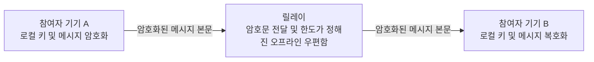

# Alice Talk — 프로젝트 개요 및 연구 계획

소개 자료: [영어·튀르키예어 애니메이션, 영어 오디오 및 인포그래픽](../../media/README.md).

**임시 명칭:** Alice Talk는 암호학 예시에서 관례적으로 사용하는 참여자 Alice와 Bob에서 착안한 임시 작업명입니다. 최종 제품명은 추후 결정합니다. 이 명칭은 다른 조직과의 제휴를 의미하지 않습니다.

**번역 안내:** 이 문서는 번역 지원을 받아 작성했으며 [영어 원문](../en/overview.md)을 기준 문서로 합니다.

**목적:** 연구비, 개발자 지원, 잠재적 협력 관계에 대한 초기 검토를 위한 자료입니다. 이 자료는 공개 검토를 위한 설명 문서와 소개 미디어로 구성되며, 구현 소스 코드와 운영 데이터는 포함하지 않습니다.

**현황:** 실험적인 암호화 메시징 프로토타입을 갖춘 독립적인 정식 공개 전 프로젝트입니다. 암호학적 구성의 조합에 대해 독립적인 보안 또는 개인정보 보호 감사가 아직 완료되지 않았습니다. 에이전트 계층과 더 폭넓은 기기 간 상호운용성은 제안 단계의 연구입니다.

## 1. 프로젝트 목적

Alice Talk는 사람들이 자신의 신원, 공유하는 내용, 수행되는 작업에 대한 실질적인 통제권을 유지하면서 여러 기기에 걸쳐 소통하고 AI 어시스턴트와 협업하는 방법을 탐구합니다.

장기적인 목표는 휴대전화, 태블릿, 컴퓨터를 아우르는 통신 계층입니다. 사용자는 다른 사람과 메시지를 주고받거나, 특정 작업에 어시스턴트를 초대하거나, 한 에이전트가 다른 에이전트에게 도움을 요청하도록 허용할 수 있을 것입니다. 상호작용이 기기나 시스템 사이를 이동하더라도 각 참여자의 키 기반 신원과 위임한 권한은 명확하게 유지되어야 합니다.

이 프로젝트는 공익을 지향합니다. 언어와 국가를 넘어선 소통, 더 접근하기 쉬운 인터페이스, 사람의 권한을 명시적으로 유지하는 협업이 그 목표입니다. 이는 평가해야 할 설계 목표입니다. 전 세계적인 서비스나 완전한 상호운용성을 갖춘 에이전트 네트워크가 이미 존재한다는 뜻은 아닙니다.

## 2. 현재 프로토타입과 제안된 작업

| 분야 | 현재 상태 |
|---|---|
| 신원 | 프로토타입에 키 기반 신원 생성 및 복원 기능이 있습니다. |
| 참여 허용 | 실험용 메시징 환경은 초대 기반으로 참여를 허용합니다. 배포 운영자는 여전히 참여 허용을 위한 인프라를 통제합니다. |
| 텍스트 메시지 | 종단간 암호화를 목표로 설계한 실험적인 일대일 텍스트 메시징이 구현되어 있습니다. 독립 감사는 완료되지 않았습니다. |
| 오프라인 전달 | 애플리케이션 계층의 한도가 정해진 RAM 전용 우편함이 제한적인 오프라인 전달 경로를 위해 암호문을 보관합니다. 릴레이를 재시작하면 대기 중인 데이터가 사라집니다. |
| 로컬 상태 | 신원 자료는 암호 구문으로 암호화된 로컬 보관함으로 보호됩니다. 암호화된 로컬 대화 기록은 선택 사항입니다. |
| 음성 및 직접 연결 | 브라우저 음성과 직접 연결에 관한 작업이 있으며, 실제 기기와 배포 환경에서 더 폭넓은 검증이 필요합니다. |
| 기기 간 소통 | 제품의 핵심 방향이지만, 호환성과 신원 수명 주기에 대한 검증이 아직 필요합니다. |
| 사람–AI 및 에이전트–에이전트 통신 | 제안된 연구 확장입니다. 완성된 프로덕션 통합을 주장하지 않습니다. |
| 보안 보증 | 개발자가 실행하는 자동화 테스트로 구현 동작을 점검합니다. 독립적인 암호학 및 개인정보 보호 감사는 아직 남아 있습니다. |

현재 메신저는 코드로 구현된 연락처 승인과 차단을 실시간 메시지, 오프라인 수신 필터링, 제어 요청에 적용합니다. 통화, 기록, 파일 수락에는 작업별 사용자 선택이 있습니다. 초대 전용 참여 허용으로 구성된 릴레이는 키 보유와 회원 자격을 확인합니다. 이는 범위가 정해진 애플리케이션·프로토콜 통제이며, 범용 에이전트 도구 권한 시스템이나 완전한 보안의 증명은 아닙니다.

이 문서 패키지는 설명과 계획을 제공합니다. 구현 배포본, 독립적으로 재현할 수 있는 테스트 보고서 또는 보안 인증서가 아닙니다.

## 3. 개념적 동작 방식

현재 메시징 프로토타입은 엔드포인트의 신원 및 콘텐츠 처리와 릴레이를 통한 전달 지원을 분리합니다.

1. 참여자가 기기에서 암호학적 신원을 생성하거나 복원합니다.
2. 초대 기반 참여 허용 절차가 실험용 메시징 환경에 대한 접근을 결정합니다.
3. 참여자의 엔드포인트들이 암호화된 일대일 세션을 설정합니다.
4. 송신 엔드포인트가 릴레이 전달 전에 메시지 본문을 암호화합니다.
5. 수신 엔드포인트가 자신이 신뢰하는 키를 기준으로 메시지의 진위를 확인하고 복호화합니다.
6. 명시적으로 마련된 오프라인 경로는 우편함의 한도 내에서 암호문을 일시적으로 보관할 수 있습니다.
7. 사용자는 암호화된 로컬 기록을 선택할 수 있습니다. 로컬 보관과 릴레이 전달은 서로 다른 문제입니다.

릴레이의 수락과 수신자의 읽음은 별개의 사건입니다. 사용할 수 있는 전송 경로가 있다는 사실만으로 다른 사람이 메시지를 수신하거나 읽었다는 점이 입증되지는 않습니다.

실시간 전송 경로는 릴레이 수락, 명시적인 오프라인 결과, 불확실한 결과를 구분합니다. 텍스트의 별도 오프라인 경로는 명시적 오프라인 결과가 있을 때만 선택합니다. 불확실한 실시간 결과가 자동으로 새로운 오프라인 전송을 일으키지는 않습니다. 이 규칙은 모호한 재시도를 제한하지만, 모든 상황에서 정확히 한 번 전달된다는 보장은 아닙니다.

## 4. 탈중앙화와 통제권

프로젝트의 탈중앙화 방향은 신원과 개인 키에 대한 통제권을 참여자에게 두고, 통신에 대한 단일 권한 주체 의존도를 줄이는 것을 목표로 합니다.

현재 프로토타입은 릴레이의 지원을 받습니다. 여전히 배포 측이 통제하는 참여 허용 절차, 연결 인프라, 엔드포인트의 동작에 의존합니다. 신뢰를 전제로 하지 않는 네트워크, 전 세계적 합의 또는 완전한 탈중앙화 거버넌스를 입증하여 제공하는 것은 아닙니다.

검토에서는 이 구분이 중요합니다. 인프라에 대한 모든 의존성을 없애지 않더라도 엔드포인트의 통제권은 유용할 수 있습니다. 후속 작업에서는 어떤 책임을 분산할 수 있는지, 어떤 가정이 남는지, 장애가 참여자에게 어떤 영향을 주는지 확인해야 합니다.

## 5. 암호학적 접근

프로토타입은 확립된 암호학적 구성을 조합합니다. 그 조합의 보안은 여전히 독립적인 평가가 필요합니다.

| 구성 | 상위 수준의 역할 |
|---|---|
| Ed25519 | 암호학적 신원 서명. |
| X3DH 방식의 사전 키 교환을 사용하는 X25519 | 초기 세션 키 합의. |
| Double Ratchet | 대화가 진행됨에 따른 세션 키 자료의 변화. |
| XChaCha20-Poly1305 | 보호 대상 콘텐츠의 인증된 암호화. |
| 암호 구문으로 암호화된 로컬 보관함 | 봉인된 형태로 저장되어 있는 동안 로컬 신원 자료를 보호. |

이 설계는 메시지 무결성, 참여하는 엔드포인트 사이의 기밀성, 세션 키 변경을 지원하는 것을 의도합니다. 이러한 의도는 전체 시스템의 종단간 보안, 순방향 비밀성 또는 침해 후 복구에 대한 형식적 증명이 아닙니다.

암호학적 신원은 키 자료에 대한 통제권을 입증합니다. 발신자가 정직하다는 점, 현실 세계의 신원이 확인되었다는 점, 요청된 작업이 승인되었다는 점을 입증하지는 않습니다.

이 개요는 구현 코드, 패킷 형식, 키 유도 매개변수, 배포 지침 및 운영 세부 사항을 의도적으로 생략합니다. 확립된 구성의 이름을 제시한다고 해서 프로토타입이 다른 제품의 프로토콜과 호환되는 것은 아닙니다.

## 6. 제안된 사람–에이전트 및 에이전트–에이전트 계층

연구 질문은 인증된 통신을 모델 출력과 독립적으로 강제되는 권한과 결합하면 협업하는 에이전트의 행동을 개선할 수 있는지입니다.

제안된 상호작용은 다음과 같은 판단을 서로 분리합니다.

- 누가 요청을 보냈는가?
- 당사자는 어떤 콘텐츠를 공유하는 데 동의했는가?
- 어떤 과제 또는 작업이 승인되었는가?
- 그 승인은 어떤 수신자, 도구 및 시간 범위를 대상으로 하는가?
- 동의가 없거나, 만료되었거나, 철회되었거나, 모호할 때 어떻게 해야 하는가?

예를 들어, 사용자는 에이전트 A가 에이전트 B에게 합성 문서의 요약을 요청하도록 허용할 수 있습니다. 그 권한은 명시된 자료와 작업으로 제한됩니다. 관련 없는 메시지, 다른 문서에 대한 접근 또는 다른 애플리케이션에서의 작업까지 자동으로 허용하지는 않습니다.

이는 제안된 평가 모델입니다. 현재 메시징 프로토타입이 이 에이전트 권한 시스템을 이미 구현한 것으로 해석해서는 안 됩니다.

## 7. 개인정보 보호 경계와 한계

유용한 평가에는 설계의 한계도 포함되어야 합니다.

- **엔드포인트:** 기기, 브라우저 또는 잠금 해제된 세션이 침해되면 비밀 정보와 평문이 노출될 수 있습니다.
- **키 배포:** 메시지 인증은 엔드포인트가 신뢰하는 신원 키를 기준으로 합니다. 키 배포와 참여자의 지문 확인 방식은 신뢰 모델에 포함됩니다. 이 개요만으로 키 바꿔치기에 대한 저항성을 입증하지는 못합니다.
- **메타데이터:** 릴레이, 호스팅 플랫폼 및 네트워크 인프라는 연결 시점, 주소 및 통신 관계를 관찰할 수 있습니다.
- **직접 경로:** 연결 구성에 따라 직접 음성 또는 데이터 연결은 참여자의 네트워크 주소를 상대 엔드포인트에 노출할 수 있습니다.
- **가용성:** 한도가 정해진 RAM 전용 오프라인 우편함은 임시적입니다. 재시작, 용량 제한 및 연결 장애는 전달에 영향을 줍니다.
- **로컬 보관:** 암호화된 기록이 선택 사항이더라도 참여자의 기기에 보관되는 데이터를 만듭니다.
- **보관함과 복구:** 도난당한 봉인 보관함은 오프라인 암호 구문 추측의 대상이 될 수 있습니다. 백업, 복원, 암호 구문의 강도는 별도 검토가 필요합니다.
- **소프트웨어 전달:** 브라우저에 전달되는 코드와 그 주변 배포 환경은 여전히 신뢰 경계의 일부입니다.
- **외부 추론:** 모델 API에 제출되는 모든 콘텐츠는 해당 제공업체가 볼 수 있습니다.
- **권한 부여:** 올바르게 인증된 메시지에도 안전하지 않거나, 오해를 유발하거나, 범위를 벗어난 지시가 포함될 수 있습니다.
- **보증:** 독립적인 보안 및 개인정보 보호 검토와 더 폭넓은 기기 검증이 여전히 필요합니다.

초기 연구에서는 합성 자료와 모의 도구를 사용할 예정입니다. 제안된 연구에는 실제 사적 대화, 자격 증명 또는 프로덕션 접근 권한이 필요하지 않습니다.

## 8. 제안된 평가

첫 번째 연구 단계에서는 세 가지 실험 조건을 비교할 예정입니다.

| 조건 | 모델에 보이는 정보와 실행 통제 |
|---|---|
| 프롬프트만 사용하는 기준선 | 모델은 작업 지시와 검증되지 않은 발신자 표식을 받습니다. 도구는 모의 도구이며 별도의 작업 권한 게이트는 없습니다. |
| 인증된 발신자 맥락 | 테스트 환경이 출처 검증 결과를 모델에 제공하지만, 독립적인 작업 권한 게이트는 추가하지 않습니다. |
| 인증된 맥락과 독립적인 권한 | 모델은 같은 출처 맥락을 봅니다. 별도의 결정론적 검사가 제안된 모의 작업을 실행 전에 차단할 수 있습니다. |

계획된 사례에는 인증된 메시지 안에 인용된 지시, 위조된 위임, 재전송 공격으로 반복된 요청, 만료된 동의, 모호한 승인, 합성 작업의 범위를 초과하려는 시도가 포함됩니다. 이는 합성 터키어·영어 대화와 모의 작업을 사용하는, 범위가 한정된 테스트입니다. 직접 발신자를 인증해도 인용된 내용의 출처나 안전성까지 인증되는 것은 아닙니다.

제안된 측정 항목은 다음과 같습니다.

- 정당한 작업의 완료.
- 모델이 시도한 미승인 작업과 실제 실행된 미승인 모의 작업을 별도로 기록합니다.
- 접근이 제한된 합성 자료의 유출.
- 정당한 작업에 대한 잘못된 거부.
- 지연 시간 및 자원 소비.
- API 또는 연산 비용.
- 반복 실행 및 선택된 모델에서의 행동.

유용한 작업의 완료를 유지하면서 미승인 시도나 실행을 줄일 수 있다는 것이 연구 가설입니다. 작업이 차단되었다는 사실만으로 모델의 판단이 개선되었다고 볼 수는 없습니다. 모델 행동과 결정론적 게이트의 효과를 구분해야 합니다. 파일럿 범위를 정한 뒤 측정 실행 전에 사례 수, 모델 계열, 반복 횟수 및 비교 기준을 명시할 예정입니다.

보고서에는 테스트 집합, 분모, 모델 구성, 실행 조건 및 한계를 명시해야 합니다. 이 저장소는 에이전트 벤치마크 결과나 효과 향상을 주장하지 않습니다.

## 9. 예시 연구 일정

다음은 가용 자원과 검토 결과에 따라 달라질 수 있는 계획의 틀입니다.

| 단계 | 예정 작업 |
|---|---|
| 1개월 차 | 위협 모델, 범위, 합성 작업 및 평가 지표를 정의합니다. |
| 2개월 차 | 기준선 실험을 구축하고 신원 및 동의에 관한 가정을 확인합니다. |
| 3개월 차 | 인증된 맥락과 별도로 강제되는 권한을 비교합니다. |
| 4개월 차 | 선택한 실험을 반복하고 실패 사례를 조사합니다. |
| 5개월 차 | 가능한 범위에서 기기, 브라우저 및 자원 사용 검증을 확대합니다. |
| 6개월 차 | 연구 결과를 정리하고 남은 공백을 파악하며, 적절한 경우 비기밀 검토 요약을 준비합니다. |

지원 규모가 작으면 파일럿의 규모도 작아집니다. 이 일정은 계약상 납품 약속이 아니며, 제안된 모든 기능이 6개월 안에 완성된다는 주장도 아닙니다.

## 10. 필요한 자원과 지원

유용한 지원은 여러 형태일 수 있습니다.

- 적정한 소규모의 모델 API 또는 추론 크레딧 할당.
- 한도가 정해진 GPU 또는 범용 연산 자원 접근.
- 리퍼비시 장비를 포함한 적절한 개발 또는 테스트 하드웨어.
- 후원받는 테스트 인프라.
- 범위가 정해진 연구를 지원하는 소액 연구비.

적절한 기여 하나도 도움이 될 수 있습니다. 프로젝트는 모든 지원자에게 모든 종류의 지원을 요청하지 않습니다.

예를 들어, 일정의 1–3개월 차를 다루는 3개월 파일럿은 US$300의 크레딧을 기준선 탐색에 US$60, 통제된 비교에 US$150, 반복 실행에 US$60, 예비비에 US$30으로 배정할 수 있습니다. 이는 계획상의 배분이며, 제공업체의 가격 견적이나 실제 수령한 자금의 기록이 아닙니다.

지원은 상환, 지분 또는 구현 지식재산의 이전, 필수 구매, 독점 조건, 강제 홍보 또는 의무적인 산출물이 없는 자발적이고 제한 없는 형태를 선호합니다. 제안과 그에 수반될 수 있는 조건은 별도 검토가 필요합니다. 이 저장소의 어떤 내용도 제안을 수락하거나, 유료 서비스를 활성화하거나, 요금 청구를 승인하지 않습니다.

## 11. 잠재적 가치와 다음 단계

가장 유망한 조사 영역은 다음과 같습니다.

- 여러 기기에 걸쳐 개인의 통제권을 명확하게 유지하는 통신.
- 대화에 대한 어시스턴트의 명시적이고 제한된 참여.
- 메시지 출처, 콘텐츠 및 작업 권한의 더 나은 분리.
- 초기의 한정된 평가 이후 에이전트와 기기 생태계 전반으로 확대하는 후속 상호운용성 실험.
- 향후 음성 및 다국어 인터페이스를 통한 더 접근하기 쉬운 상호작용.

다음으로 의미 있는 이정표는 증거입니다. 범위가 한정된 시연, 명확하게 설명된 측정, 솔직한 실패 분석, 관련 보안 가정에 대한 독립적인 평가가 필요합니다.

## 12. 검토와 기밀 유지

이 저장소는 검토자가 프로젝트의 방향과 소규모 기여의 적합성을 평가하도록 돕기 위한 것입니다. 비공개 구현 코드의 보안을 입증할 수는 없습니다.

구현 소스, 자격 증명, 비공개 신청 기록 또는 실제 운영 중인 구성을 포함하지 않습니다. 비공개 시스템이나 구현 지식재산에 대한 접근 권한도 부여하지 않습니다. 더 심층적인 기술 검토나 추가 비기밀 연구 결과의 자발적 공유는 별도로 논의할 사안입니다.

프로젝트 소유자: [kemalayazx](https://github.com/kemalayazx). 해당 프로필에서 이용 가능한 경로 또는 이 자료를 전달받은 기존 연락 경로를 이용해 주십시오.

## 13. 엔지니어링 근거와 개발 규모

**검토한 스냅샷 날짜: 2026년 10월 31일.** 이 수치는 선택한 비공개 구현 스냅샷과 개발자가 수행한 검사를 설명합니다. 독립 감사 결과나 프로덕션 보증이 아니며, 제안된 에이전트 연구의 측정 결과도 아닙니다.

### 자동화 테스트

기존 전체 자동화 테스트 모음을 새로 실행한 결과 **737개 중 737개가 통과**했습니다. **실패 0개, 취소 0개, 건너뜀 0개**입니다. 세부적으로 암호학 62개, 암호화 세션 42개, 프로토콜 56개, 신뢰·참여 허용 68개, 클라이언트 376개, 서버 118개, 도구 15개입니다.

처음의 제한된 환경에서는 임시 로컬 테스트 연결을 열 수 없어 통과하지 못했습니다. 필요한 로컬 테스트 권한을 갖춘 후속 실행은 성공했습니다. 두 실행 사이에 구현을 변경하지 않았습니다. 성공한 결과가 환경 검사 실패를 지우거나 원격 배포를 다시 시험했다는 뜻이 되어서는 안 됩니다.

비공개 개발 기록에는 이전 전체 테스트 결과도 있습니다. 2026년 9월 6일 702개, 9월 7일 725개, 9월 9일 737개입니다. 날짜가 있는 개발 기록이며 서로 다른 독립 인증도, 합산할 수치도 아닙니다. 연속적으로 발전한 서로 다른 스냅샷의 결과입니다.

### 발견하고 처리한 문제의 예

| 문제 범주 | 기록된 수정과 회귀 테스트의 초점 |
|---|---|
| 취소나 종료 후에도 작업이 계속됨 | 취소 검사, 명시적 자원 해제, 순차적인 파일 정리를 도입하여 오래된 비동기 작업이 중지된 런타임을 계속 변경하지 못하게 했습니다. |
| 겹치는 신원 진입 작업 | 각 시도가 수명 주기 소유권을 갖도록 했습니다. 대체된 작업은 오래된 신원 상태를 설치하거나 교체된 저장소를 다시 봉인할 수 없습니다. 전용 회귀 사례로 경쟁 상태를 검사합니다. |
| 연결 전에 통화가 활성 상태로 표시됨 | 통화 상태는 연결 준비와 실제 연결된 미디어 경로를 구분합니다. 신호 교환 시작만으로 통화가 연결되었다고 간주하지 않습니다. |
| 안전하지 않거나 불완전한 연결 설정 | 유효하지 않은 핸드셰이크나 구성 상태를 부분 설정으로 계속 진행하지 않고 거부하도록 검증을 강화했습니다. |
| 진단에서 지나친 맥락이 노출됨 | 실패 진단을 한정된 상태 범주와 참·거짓 값으로 제한했습니다. 테스트는 비공개 값의 거부 또는 가림 처리를 확인합니다. |

이 예시는 기록된 개발 작업을 요약합니다. 악용 지침, 구현 패치, 비공개 형식이나 운영 구성을 공개하지 않으며, 관련된 모든 실패 유형이 제거되었다는 뜻도 아닙니다.

### 미해결 또는 미검증 영역

비공개 통합 기록에는 실시간·오프라인 메시징, 재연결, 재시작 후 재전송되지 않음을 확인한 성공 사례가 있습니다. 같은 기록에는 원인이 아직 설명되지 않은 간헐적 오프라인 전달 시간 초과도 있습니다. 이후 실행의 성공과 진단 개선이 해당 결함의 수정을 **입증하지는 않습니다**.

연결이 끊긴 상태에서 참여 권한을 조정할 때 여전히 충돌이 드러날 수 있습니다. 이는 입증된 합의 메커니즘이 아닙니다. 더 넓은 신원 수명 주기 범위, 실제 기기의 직접 음성·데이터 경로, 실제 피어 간 파일 전송 동작은 추가 검증이 필요합니다. 자동화 테스트 통과와 이러한 공백은 동시에 존재할 수 있습니다.

### 코드 규모 측정

다음 수치는 애플리케이션, 공유 라이브러리, UI, 독립 개발 도우미에서 선택한 버전 관리 대상 소스 및 테스트 파일을 포함합니다. 물리적 줄 수에는 빈 줄과 주석이 포함됩니다.

| 범주 | 파일 수 | 물리적 줄 수 |
|---|---:|---:|
| 테스트를 제외한 애플리케이션·공유 라이브러리 TypeScript | 87 | 27,387 |
| TypeScript 테스트 | 70 | 18,852 |
| UI HTML 및 CSS | 2 | 2,205 |
| 독립 개발 도우미 | 4 | 2,226 |
| 도우미 테스트 | 3 | 251 |
| **선택한 소스와 테스트 합계** | **166** | **50,921** |

문서, 의존성·서드파티 파일, 잠금 파일, 패키지 매니페스트, 배포·구성 파일, 생성된 번들 및 빌드 결과물은 제외합니다. 활성 런타임에 연결되지 않은 실험 코드도 포함될 수 있습니다. 보존된 코드의 특정 시점 규모이며, 지금까지 작성한 전체 줄 수나 개인의 저작 기여, 기능 완성도, 보안 수준을 측정하지 않습니다.

원시 로그, 비공개 소스 경로 및 구현 이력은 이 소개 패키지에 포함하지 않습니다. 적절한 경우 더 자세한 비기밀 근거를 별도로 논의할 수 있습니다.

개발 도우미 행은 선택한 JavaScript/TypeScript 도우미를 집계합니다. 셸 도구와 빌드 구성은 이 측정에서 제외합니다.
