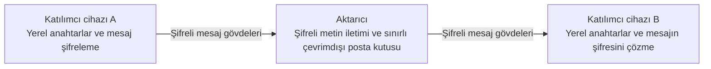

# Alice Talk — Projeye Genel Bakış ve Araştırma Planı

**Çeviri notu:** Bu metin Türkçe çeviridir. Anlam veya yorum farklılığında [esas İngilizce metin](../en/overview.md) geçerlidir.

**Çalışma adı:** “Alice Talk” geçici bir addır; kriptografi örneklerinde geleneksel olarak kullanılan Alice ve Bob katılımcılarından esinlenmiştir. Nihai ürün adı daha sonra seçilecektir. Çalışma adı, başka bir kuruluşla herhangi bir bağlantı olduğu anlamına gelmez.

**Amaç:** Hibe, geliştirici desteği ve olası iş ortaklığı için ilk değerlendirmede kullanılacak materyal sunmak. Bu paket, ilerideki olası bir kamuya açık yayımdan önce özel bir depoda hazırlanmaktadır.

**Durum:** Deneysel bir şifreli mesajlaşma prototipi bulunan, bağımsız ve henüz yayımlanmamış bir proje. Kriptografik bileşiminin bağımsız güvenlik veya gizlilik denetimi tamamlanmamıştır. Ajan katmanı ve cihazlar arasında daha kapsamlı birlikte çalışabilirlik, önerilen araştırma alanlarıdır.

## 1. Projenin amacı

Alice Talk, insanların kimlikleri, paylaştıkları içerik ve gerçekleştirilen eylemler üzerinde anlamlı bir denetimi koruyarak farklı cihazlar üzerinden nasıl iletişim kurabileceğini ve yapay zekâ asistanlarıyla nasıl çalışabileceğini araştırır.

Uzun vadeli hedef, telefonları, tabletleri ve bilgisayarları kapsayan bir iletişim katmanıdır. Bir kişi başka bir kişiyle mesajlaşabilir, belirli bir göreve bir asistanı davet edebilir veya bir ajanın başka bir ajandan yardım istemesine izin verebilir. Etkileşim cihazlar veya sistemler arasında ilerlerken her katılımcının anahtar tabanlı kimliği ve devrettiği yetkiler açık kalmalıdır.

Projenin çıkış noktası kamu yararıdır: diller ve ülkeler arasında iletişim, daha erişilebilir arayüzler ve insanın yetkisini açık tutan iş birliği. Bunlar değerlendirilmesi gereken tasarım hedefleridir. Dünya çapında bir hizmetin veya eksiksiz, birlikte çalışabilir bir ajan ağının hâlihazırda var olduğunu göstermezler.

## 2. Mevcut prototip ve önerilen çalışmalar

| Alan | Mevcut durum |
|---|---|
| Kimlik | Anahtar tabanlı kimlik oluşturma ve geri yükleme prototipte mevcuttur. |
| Katılım | Deneysel mesajlaşma ortamına davetiye ile kabul edilir. Kabul altyapısının denetimi, dağıtımı işletenlerde kalır. |
| Metin mesajları | Uçtan uca şifreleme için tasarlanmış deneysel bire bir metin mesajlaşması uygulanmıştır; bağımsız denetimden geçmemiştir. |
| Çevrimdışı teslim | Uygulama düzeyinde, kapasitesi sınırlı ve yalnızca RAM kullanan bir posta kutusu, sınırlı bir çevrimdışı teslim yolu için şifreli metni tutar. Aktarıcının yeniden başlatılması, kuyruktaki verilerin kaybına yol açar. |
| Yerel durum | Kimlik materyali, parola ile şifrelenmiş yerel bir kasayla korunur; şifreli yerel konuşma geçmişi isteğe bağlıdır. |
| Ses ve doğrudan bağlantılar | Tarayıcıda ses ve doğrudan bağlantı çalışmaları mevcuttur; daha kapsamlı fiziksel cihaz ve dağıtım doğrulaması gerektirir. |
| Cihazlar arasında iletişim | Ürünün temel yönelimlerinden biridir; uyumluluk ve kimlik yaşam döngüsü doğrulaması hâlâ gereklidir. |
| İnsan–yapay zekâ ve ajan–ajan iletişimi | Önerilen bir araştırma uzantısıdır; tamamlanmış bir üretim entegrasyonu olduğu iddia edilmez. |
| Güvenlik güvencesi | Geliştiricinin çalıştırdığı otomatik testler, uygulamanın davranışını sınar; bağımsız kriptografi ve gizlilik denetimi henüz tamamlanmamıştır. |

Bu dokümantasyon paketi bir açıklama ve plan sunar. Uygulama dağıtımı, bağımsız olarak yeniden üretilebilir bir test raporu veya güvenlik sertifikası değildir.

## 3. Kavramsal işleyiş

Mevcut mesajlaşma prototipi, uç noktalardaki kimlik ve içerik işlemlerini aktarıcı destekli teslimden ayırır.

1. Katılımcı, bir cihazda kriptografik kimlik oluşturur veya kimliğini geri yükler.
2. Davetiye tabanlı kabul, deneysel mesajlaşma ortamına erişimi belirler.
3. Katılımcıların uç noktaları, şifreli bire bir oturum kurar.
4. Gönderen uç nokta, aktarıcı üzerinden teslimden önce mesaj gövdesini şifreler.
5. Alıcı uç nokta, mesajın özgünlüğünü güvendiği anahtarlara göre kontrol eder ve mesajın şifresini çözer.
6. Açıkça tanımlanmış bir çevrimdışı yol, posta kutusunun sınırları içinde şifreli metni geçici olarak tutabilir.
7. Kullanıcı, şifreli yerel geçmişi seçebilir; yerel saklama ve aktarıcı üzerinden teslim ayrı konulardır.

Aktarıcının bir mesajı kabul etmesi ile alıcının mesajı okuması farklı olaylardır. Kullanılabilir bir iletim yolunun bulunması, başka bir kişinin mesajı aldığını veya okuduğunu kanıtlamaz.

## 4. Merkezsizleşme ve denetim

Projenin merkezsizleşme yönelimi, kimliğin ve özel anahtarların denetimini katılımcılara verir; iletişimleri üzerinde tek bir otoriteye bağımlılığı azaltmayı amaçlar.

Mevcut prototip, aktarıcı desteklidir. Dağıtımı işletenlerin denetimindeki kabul mekanizmasına, bağlantı altyapısına ve uç noktaların davranışına hâlâ bağımlıdır. Güven varsayımı gerektirmediği gösterilmiş bir ağ, küresel uzlaşı veya tamamen merkezsiz bir yönetişim sunmaz.

Bu ayrım değerlendirme açısından önemlidir. Her altyapı bağımlılığı ortadan kalkmasa da uç noktaların denetiminin katılımcıda olması yararlı olabilir. Sonraki çalışmalar, hangi sorumlulukların dağıtılabileceğini, hangi varsayımların kaldığını ve arızaların katılımcıları nasıl etkilediğini ortaya koymalıdır.

## 5. Kriptografik yaklaşım

Prototip, yerleşik kriptografik yapıları bir araya getirir. Bu bileşimin güvenliği hâlâ bağımsız değerlendirme gerektirir.

| Yapı | Genel işlev |
|---|---|
| Ed25519 | Kriptografik kimlik imzaları. |
| X25519 with an X3DH-style prekey exchange | İlk oturum için anahtar anlaşması. |
| Double Ratchet | Konuşma ilerledikçe oturum anahtar materyalinin evrilmesi. |
| XChaCha20-Poly1305 | Korunan içeriğin kimlik doğrulamalı şifrelenmesi. |
| Passphrase-encrypted local vault | Yerel kimlik materyalinin kapalı biçimde saklanırken korunması. |

Tasarım; mesaj bütünlüğünü, katılımcı uç noktalar arasındaki gizliliği ve oturum anahtarlarının değişmesini desteklemeyi amaçlar. Bu amaçlar, sistemin tamamı için uçtan uca güvenliğin, ileri gizliliğin veya ele geçirilme sonrasında toparlanmanın biçimsel kanıtı değildir.

Kriptografik kimlik, anahtar materyalinin denetimini gösterir. Gönderenin dürüst olduğunu, gerçek dünyadaki kimliğinin doğrulandığını veya istenen bir eylemin yetkilendirildiğini göstermez.

Bu genel bakış; uygulama kodunu, paket biçimlerini, anahtar türetme parametrelerini, dağıtım talimatlarını ve operasyonel ayrıntıları bilinçli olarak içermez. Yerleşik yapıların adlarının verilmesi, prototipi başka bir ürünün protokolüyle uyumlu hâle getirmez.

## 6. Önerilen insan–ajan ve ajan–ajan katmanı

Araştırma sorusu, kimliği doğrulanmış iletişimin, model çıktısından bağımsız olarak uygulanan izinlerle birlikte, iş birliği yapan ajanların davranışını iyileştirip iyileştiremeyeceğidir.

Önerilen bir etkileşimde şu kararlar birbirinden ayrı tutulur:

- İsteği kim gönderdi?
- Kişi hangi içeriğin paylaşılmasına onay verdi?
- Hangi görev veya eylem yetkilendirildi?
- Bu yetkilendirme hangi alıcıyı, aracı ve zaman aralığını kapsıyor?
- Onay yoksa, süresi dolmuşsa, geri çekilmişse veya belirsizse ne olmalı?

Örneğin bir kişi, Ajan A'nın Ajan B'den sentetik bir belgeyi özetlemesini istemesine izin verebilir. Bu izin, belirtilen materyal ve görevle sınırlı olur. İlgisiz mesajları, başka belgelere erişimi veya başka bir uygulamadaki eylemleri kendiliğinden yetkilendirmez.

Bu, önerilen bir değerlendirme modelidir. Mevcut mesajlaşma prototipinin bu ajan izin sistemini zaten uyguladığı düşünülmemelidir.

## 7. Gizlilik sınırları ve kısıtlar

Yararlı bir değerlendirme, tasarımın sınırlarını da içermelidir:

- **Uç noktalar:** ele geçirilmiş bir cihaz, tarayıcı veya kilidi açık oturum; sırları ve açık metni açığa çıkarabilir.
- **Anahtar dağıtımı:** mesajın kimlik doğrulaması, uç noktanın güvendiği kimlik anahtarlarına göredir. Bu anahtarların nasıl dağıtıldığı ve katılımcıların parmak izlerini nasıl doğruladığı, güven modelinin parçasıdır. Bu genel bakış, anahtar ikamesine karşı direnç bulunduğunu ortaya koymaz.
- **Üstveri:** aktarıcılar, barındırma platformları ve ağ altyapısı; bağlantı zamanlamasını, adresleri ve iletişim ilişkilerini gözlemleyebilir.
- **Doğrudan yollar:** bağlantı yapılandırmasına bağlı olarak, doğrudan ses veya veri bağlantısı bir katılımcının ağ adresini diğer uç noktaya gösterebilir.
- **Kullanılabilirlik:** kapasitesi sınırlı ve yalnızca RAM kullanan çevrimdışı posta kutusu geçicidir. Yeniden başlatmalar, kapasite sınırları ve bağlantı hataları teslimi etkiler.
- **Yerel saklama:** isteğe bağlı şifreli geçmiş de katılımcının cihazında saklanan veri oluşturur.
- **Kasa ve kurtarma:** çalınan kapalı bir kasa, çevrimdışı parola tahminine maruz kalabilir. Yedekleme, geri yükleme ve parola gücü ayrı değerlendirme gerektirir.
- **Yazılımın sunulması:** tarayıcıya sunulan kod ve onu çevreleyen dağıtım, güven sınırının parçası olmaya devam eder.
- **Haricî çıkarım:** sağlayıcı, model API'sine gönderilen içeriği görür.
- **Yetkilendirme:** kimliği doğru biçimde doğrulanmış bir mesaj bile güvensiz, yanıltıcı veya kapsam dışı talimatlar içerebilir.
- **Güvence:** bağımsız güvenlik ve gizlilik incelemesi ile daha kapsamlı cihaz doğrulaması hâlâ gereklidir.

İlk araştırmalarda sentetik materyal ve taklit araçlar kullanılması öngörülür. Önerilen çalışma için gerçek özel konuşmalar, kimlik bilgileri veya üretim ortamına erişim gerekmez.

## 8. Önerilen değerlendirme

İlk araştırma aşamasında üç deney koşulunun karşılaştırılması önerilir:

| Koşul | Modele gösterilen bilgi ve uygulanan denetim |
|---|---|
| Yalnızca istem içeren başlangıç koşulu | Model, görev talimatlarını ve doğrulanmamış gönderen etiketlerini alır. Araçlar taklit edilir; ayrı bir eylem izni kontrolü yoktur. |
| Kimliği doğrulanmış gönderen bağlamı | Deney düzeneği, modelin dikkate alması için bir köken doğrulama sonucu ekler. Bağımsız bir eylem izni kontrolü eklemez. |
| Kimliği doğrulanmış bağlam ve bağımsız izinler | Model aynı köken bağlamını görür; ayrı bir deterministik kontrol, önerilen taklit eylemi yürütülmeden önce engelleyebilir. |

Planlanan örnekler arasında kimliği doğrulanmış mesajların içindeki alıntı talimatlar, sahte yetki devirleri, yeniden oynatılan istekler, süresi dolmuş onaylar, belirsiz yetkilendirmeler ve sentetik görevin kapsamını aşma girişimleri bulunur. Bunlar, sentetik Türkçe/İngilizce konuşmalar ve taklit eylemlerle yürütülecek sınırlı testlerdir. Doğrudan gönderenin kimliğinin doğrulanması, alıntılanan içeriğin kökenini veya güvenliğini doğrulamaz.

Önerilen ölçütler şunlardır:

- Meşru görevin tamamlanması.
- Modelin giriştiği yetkisiz eylemler ile yürütülen yetkisiz taklit eylemlerin ayrı ayrı kaydedilmesi.
- Sentetik kısıtlı materyalin ifşa edilmesi.
- Meşru işin hatalı biçimde reddedilmesi.
- Gecikme ve kaynak tüketimi.
- API veya hesaplama maliyeti.
- Tekrarlanan çalıştırmalarda ve seçilen modellerde davranış.

Hipotez, yetkisiz girişimler veya yürütmeler azaltılırken yararlı görev tamamlama düzeyinin korunabileceğidir. Bir eylemin engellenmesi tek başına modelin daha iyi muhakeme ettiğini göstermez; sonuçlar, model davranışını deterministik kontrolün etkisinden ayırmalıdır. Pilotun kapsamı kesinleştirildikten sonra örnek sayıları, seçilen model aileleri, tekrarlar ve karşılaştırma ölçütleri, ölçümlü çalıştırmalardan önce açıklanması öngörülür.

Bir rapor; test kümesini, oranların hesaplandığı toplam sayıları, model yapılandırmasını, çalıştırma koşullarını ve kısıtları belirtmelidir. Bu depoda ajanlara ilişkin bir kıyaslama sonucu veya etkinlik artışı iddia edilmez.

## 9. Örnek araştırma takvimi

Aşağıdaki çerçeve bir planlama aracıdır; mevcut kaynaklara ve inceleme bulgularına bağlıdır.

| Aşama | Planlanan çalışma |
|---|---|
| 1. ay | Tehdit modelini, kapsamı, sentetik görevleri ve değerlendirme ölçütlerini tanımlamak. |
| 2. ay | Başlangıç deneylerini kurmak; kimlik ve onaya ilişkin varsayımları kontrol etmek. |
| 3. ay | Kimliği doğrulanmış bağlamı, ayrıca uygulanan izinlerle karşılaştırmak. |
| 4. ay | Seçilen deneyleri tekrarlamak ve başarısızlık örneklerini incelemek. |
| 5. ay | Uygun olduğu ölçüde cihaz, tarayıcı ve kaynak kullanımı doğrulamasını genişletmek. |
| 6. ay | Bulguları bir araya getirmek, kalan eksikleri belirlemek ve uygun olduğunda gizli bilgi içermeyen bir değerlendirme özeti hazırlamak. |

Daha küçük bir hibe, daha küçük bir pilota karşılık gelir. Bu takvim, sözleşmesel bir teslim taahhüdü veya önerilen her özelliğin altı ay içinde tamamlanacağı iddiası değildir.

## 10. Kaynak ihtiyaçları ve destek

Yararlı destek farklı biçimlerde sunulabilir:

- Mütevazı miktarda model API'si veya çıkarım kredisi.
- Sınırları belirlenmiş GPU veya genel hesaplama erişimi.
- Yenilenmiş ekipman dâhil, geliştirme veya test için uygun donanım.
- Sponsorlu test altyapısı.
- Kapsamı belirlenmiş araştırmayı destekleyen küçük bir hibe.

Uygun tek bir katkı da yararlı olabilir; proje, her destekçiden bütün kategorileri sağlamasını istememektedir.

Örnek olarak, takvimin 1–3. aylarını kapsayan üç aylık bir pilotta US$300 tutarında kredi tahsisi kullanılabilir: başlangıç araştırması için US$60, kontrollü karşılaştırmalar için US$150, tekrarlanan çalıştırmalar için US$60 ve beklenmedik ihtiyaçlar için US$30. Bunlar planlama tahsisleridir; sağlayıcı fiyat teklifleri veya alınmış fonların kaydı değildir.

Geri ödeme, hisse veya uygulamaya ilişkin fikrî mülkiyet devri; zorunlu satın alma, münhasırlık, mecburi tanıtım ya da zorunlu teslimatlar içermeyen, koşulsuz ve gönüllü destek tercih edilir. Teklifler ve önerilen koşullar ayrı inceleme gerektirir. Bu depodaki hiçbir ifade bir teklifi kabul etmez, ücretli bir hizmeti etkinleştirmez veya ücret tahsilatını yetkilendirmez.

## 11. Olası değer ve sonraki adımlar

Araştırılması en umut verici alanlar şunlardır:

- Cihazlar arasında kişinin denetimini açık tutan iletişim.
- Asistanların bir konuşmaya açıkça tanımlanmış ve sınırlı katılımı.
- Mesajın kökeni, içeriği ve eylem izinlerinin daha iyi ayrılması.
- İlk sınırlı değerlendirmenin sonrasında, ajan ve cihaz ekosistemleri arasında yapılacak birlikte çalışabilirlik deneyleri.
- Gelecekteki sesli ve çok dilli arayüzlerle daha erişilebilir etkileşim.

Bir sonraki anlamlı dönüm noktası kanıttır: sınırları belirlenmiş bir gösterim, açıkça tarif edilmiş ölçümler, dürüst bir başarısızlık analizi ve ilgili güvenlik varsayımlarının bağımsız değerlendirmesi.

## 12. Değerlendirme ve gizlilik

Bu depo, değerlendiricinin projenin yönünü ve küçük bir katkının uygunluğunu incelemesine yardımcı olmayı amaçlar. Özel uygulama kodunun güvenliğini ortaya koyamaz.

Uygulama kaynak kodu, kimlik bilgileri, özel başvuru kayıtları veya canlı operasyonel yapılandırma içermez. Özel sistemlere veya uygulamaya ilişkin fikrî mülkiyete erişim vermez. Daha derin bir teknik inceleme veya gizli bilgi içermeyen ek bulguların gönüllü olarak paylaşılması ayrı bir görüşmenin konusu olur.

Proje sahibi: [kemalayazx](https://github.com/kemalayazx). İletişim için bu profildeki mevcut kanalları veya bu materyalin paylaşıldığı yazışmayı kullanın.

## 13. Mühendislik kanıtları ve geliştirme ölçeği

**İncelenen durum: 31 Ekim 2026.** Bu rakamlar seçilen özel uygulama sürümünü ve geliştiricinin yürüttüğü kontrolleri anlatır. Bağımsız denetim sonucu, üretim ortamı garantisi veya önerilen ajan araştırmasının ölçümleri değildir.

### Otomatik testler

Mevcut tam otomatik test takımının güncel çalıştırmasında **737 testin 737’si geçti**. **0 başarısız, 0 iptal edilmiş ve 0 atlanmış test** vardı. Dağılım: 62 kriptografi, 42 şifreli oturum, 56 protokol, 68 güven ve katılım, 376 istemci, 118 sunucu ve 15 araç testi.

İlk kısıtlı çalıştırma, geçici yerel test bağlantılarını açamadığı için başarılı olmadı. Gerekli yerel test izinleriyle yapılan sonraki çalıştırma başarıyla tamamlandı. İki çalıştırma arasında uygulama kodu değiştirilmedi. Başarılı sonuç, başarısız ortam kontrolünü yok saydırmaz; uzak kurulumların yeniden test edildiği anlamına da gelmez.

Özel geliştirme kayıtlarında 6 Eylül 2026’da 702, 7 Eylül’de 725 ve 9 Eylül’de 737 testlik önceki tam takım sonuçları da yer alır. Bunlar tarihli geliştirme kayıtlarıdır; ayrı bağımsız doğrulamalar değildir ve toplanacak sayılar olarak görülmemelidir. Birbirini izleyen farklı kod durumlarına aittir.

### Bulunan ve ele alınan sorunlardan örnekler

| Sorun türü | Kayda geçen düzeltme ve regresyon odağı |
|---|---|
| İptal veya kapanmadan sonra işlerin sürmesi | Durdurulmuş bir çalışma ortamını eski asenkron işlemlerin değiştirmesini önlemek için iptal kontrolleri, açık kaynak serbest bırakma ve sıralı dosya temizliği eklendi. |
| Çakışan kimlik giriş işlemleri | Giriş denemelerine yaşam döngüsü sahipliği verildi; geçersiz kılınan işlemler eski kimlik durumunu yerleştiremez veya yerine geçen veri deposunu yeniden mühürleyemez. Özel regresyon örnekleri bu yarışları kapsar. |
| Bağlantı oluşmadan aramaların etkin görünmesi | Arama durumu, bağlantı kurulumunu bağlı medya yolundan ayırır. Yalnızca sinyalleşmenin başlaması tamamlanmış arama sayılmaz. |
| Güvensiz veya eksik bağlantı kurulumu | Doğrulama sıkılaştırıldı; geçersiz el sıkışma ve yapılandırma durumları kısmi kurulumla sürdürülmek yerine reddedilir. |
| Tanılama bilgilerinin gereğinden fazla bağlam açığa çıkarması | Hata tanılamaları sınırlı durum kategorileri ve doğru/yanlış değerleriyle kısıtlandı. Testler özel değerlerin reddedilmesini veya gizlenmesini kontrol eder. |

Bu örnekler kayıtlı geliştirme çalışmalarını özetler. İstismar talimatları, uygulama yamaları, özel biçimler veya işletim yapılandırması vermez; ilgili bütün hata türlerinin ortadan kalktığını da kanıtlamaz.

### Çözülmemiş veya doğrulanmamış alanlar

Özel entegrasyon kayıtlarında başarılı canlı ve çevrimdışı mesajlaşma, yeniden bağlanma ve yeniden başlatma sonrasında tekrar oynatılmama denemeleri vardır. Aynı kayıtlar, nedeni açıklanamamış aralıklı çevrimdışı teslim zaman aşımlarını da içerir. Sonraki başarılı çalıştırmalar ve daha iyi tanılama, bu hatanın düzeltildiğini **kanıtlamaz**.

Bağlantı kesikken katılım haklarının uzlaştırılmasında hâlâ çakışma görülebilir; bu, kanıtlanmış bir uzlaşma mekanizması değildir. Daha geniş kimlik yaşam döngüsü kapsamı, gerçek cihazlardaki doğrudan ses/veri yolları ve gerçek eşler arası dosya aktarımı davranışı ek doğrulama gerektirir. Otomatik testlerin geçmesi bu eksiklerle birlikte mümkündür.

### Kod büyüklüğü ölçümü

Aşağıdaki sayılar uygulama, ortak kütüphaneler, arayüz ve bağımsız geliştirici yardımcılarındaki sürüm kontrolüyle izlenen seçili kaynak ve test dosyalarını kapsar. Fiziksel satır sayısına boş satırlar ve yorumlar dahildir.

| Kategori | Dosya | Fiziksel satır |
|---|---:|---:|
| Testler hariç uygulama ve ortak kütüphane TypeScript kodu | 87 | 27.387 |
| TypeScript testleri | 70 | 18.852 |
| Arayüz HTML ve CSS dosyaları | 2 | 2.205 |
| Bağımsız geliştirici yardımcıları | 4 | 2.226 |
| Yardımcı araç testleri | 3 | 251 |
| **Seçili kaynak ve testlerin toplamı** | **166** | **50.921** |

Belgeler, bağımlılık ve üçüncü taraf dosyaları, kilit dosyaları, paket bildirimleri, dağıtım/yapılandırma dosyaları, üretilmiş paketler ve derleme çıktıları hariçtir. Sayım, etkin çalışma ortamına bağlanmamış deneysel kodları da içerir. Bu, korunmuş kodun belirli bir andaki büyüklüğüdür; bugüne kadar yazılan toplam satırı, kişisel yazarlığı, özelliklerin tamamlanma düzeyini veya güvenliği ölçmez.

Ham günlükler, özel kaynak yolları ve uygulama geçmişi bu tanıtım paketinin dışındadır. Uygun olursa daha ayrıntılı, gizli olmayan kanıtlar ayrıca görüşülebilir.
