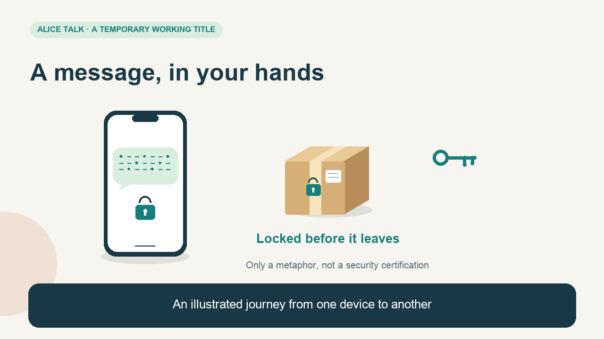
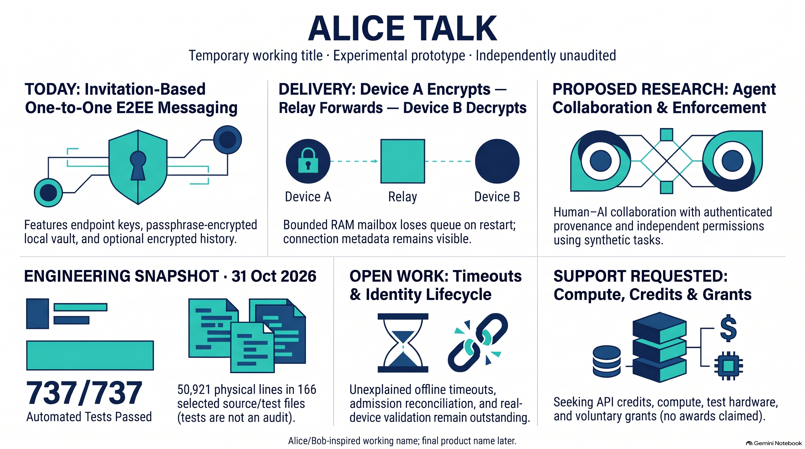

# Presentation media

These media introduce the [English project brief](../docs/en/overview.md). The written brief is the reference for capabilities, limitations and engineering figures. Alice Talk is a temporary working title inspired by the conventional Alice/Bob cryptographic examples.

## Animated introduction

**A message, in your hands** follows a message as it becomes a locked parcel, travels with a courier, waits when the other phone is offline, and becomes readable at the recipient's device.

| Edition | Film | Exact narration input | Captions |
|---|---|---|---|
| English · about 3:12 | [Watch or download](alice-talk-courier.en.mp4) | [Reading text](courier-narration.en.md) | [SRT](courier-captions.en.srt) |
| Türkçe · yaklaşık 3:34 | [İzle veya indir](alice-talk-courier.tr.mp4) | [Anlatım metni](courier-narration.tr.md) | [SRT](courier-captions.tr.srt) |

The films use original drawn characters and programmed 2D animation, with existing local English and Turkish synthetic voices and a quiet, originally synthesized musical accompaniment. They include readable on-screen captions. The [storyboard](courier-storyboard.en.md) records the scene boundaries and intended meaning. The text files are the exact synthesis inputs, not independently transcribed speech.

The parcel is a teaching metaphor for an experimental encryption design. Delivery information may remain visible. The current prototype depends on a relay. The multi-stop courier sequence is explicitly labeled **proposed routing**; it does not claim that a deployed network hides every earlier hop or that neighboring connections are invisible. The broader AI-agent permission layer is also labeled **proposed research**. Current contact and action-specific messenger controls are distinguished from that future layer.

The film states the temporary-memory queue's limits, uncertainty in delivery status, device/key trust requirements and remaining work. The dated **737/737** developer-run result does not certify security. An offline timeout and an invitation-bookkeeping conflict remain unresolved. Wider real-device validation and independent review are still needed.

## Infographic

The English landscape infographic was generated with NotebookLM from the sanitized project brief and engineering summary. An initial version was rejected for misleading wording; this version was visually compared with those sources.

“E2EE messaging” describes the prototype's design objective, not an independently audited security property. The vault protects local identity material; only local conversation history is optional. Human–AI and agent–agent permissions remain proposed research.

The **50,921 physical lines in 166 selected source/test files** include comments, blank lines and experimental code. They are not a lifetime authorship total. The written brief states exclusions and unresolved issues.

## Reference audio

The [English reference narration](reference-narration.en.m4a), approximately **2:57**, is a separate listening aid synthesized locally from the reviewed [briefing script](briefing-script.en.md). Its [reading text](reference-narration.en.md) is the exact synthesis input. It is not a conversational podcast or a human recording.

## Supplementary production documents

The [detailed English explainer script](video-script.en.md) and [technical storyboard](video-storyboard.en.md) remain supplementary production drafts. They are separate from the finished courier films.

## Production and review

The animated screenplay received internal agent checks for evidence boundaries and English/Turkish consistency, followed by editing. Representative frames from all scenes were checked for legibility and layout; the completed media were checked for decodability, duration and audio integrity. This does not claim an independent security audit or a full independent word-for-word listening review.

Private implementation code and operational details were not supplied as generation sources. The package contains no API credentials, implementation source, raw test logs or private infrastructure addresses. Media generation does not imply endorsement by any technology provider, auditor or funding organization. More interpretive NotebookLM audio/video drafts remain outside this package.
